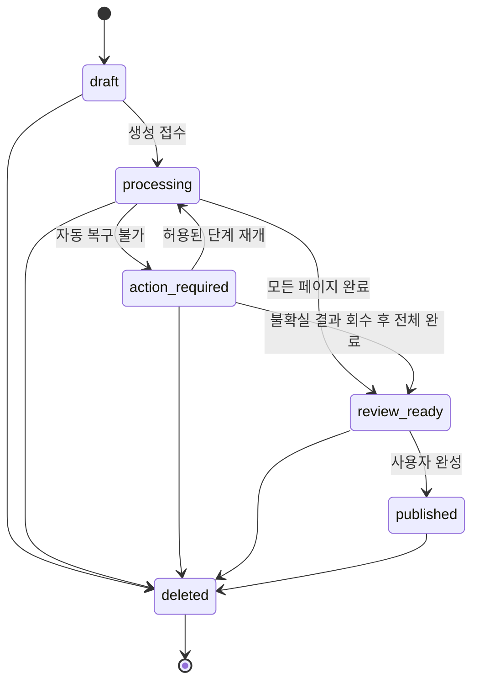

# AI 사진첩 공통 데이터와 모듈 계약

> 통합 전 이력입니다. 현재 기준은 [프로젝트 README](../../../README.md)에서 확인합니다.

- 버전: 1.2
- 작성일: 2026-10-15, Asia/Seoul
- 용도: 화면·API·저장·AI·worker를 병렬 구현하기 위한 공통 기준
- 기준 자료: [기능요구명세서](기능요구명세서.md) v1.0, [상세설계](상세설계.md) v0.3, 이 세션의 사용자 결정

이 문서의 데이터 필드, 상태, API, 모듈 경계를 v1 구현 기준으로 고정한다. 상세설계의 같은 항목이 제안 또는 미정으로 남아 있으면 이 문서의 구체적인 계약을 적용한다. 이후 사용자가 변경한 요구사항이 우선하며, 계약 변경 시 버전과 영향을 받는 작업을 함께 기록한다. 다른 세션이 편집 중인 원본 문서는 이 세션에서 덮어쓰지 않는다.

목표는 모듈 담당자가 다른 모듈의 구현 완료를 기다리지 않고 같은 샘플 데이터와 인터페이스로 작업하는 것이다. 기존 서비스의 실제 파일 재사용 목록, 배포 사업자, 큐 제품은 이 계약과 별도로 정한다.

## 1. 이번에 고정하는 결정

| 항목 | v1 기준 | 근거 |
|---|---|---|
| 이미지 모델 | GPT Image 2를 이미지 변환 adapter의 기본 모델로 사용 | 사용자가 원본 보존·3:4 변환 품질 확인을 보고함 |
| 검증 범위 | 품질 확인은 재선정의 선행 조건에서 제거. 운영 연동의 시간·비용·timeout 처리는 별도 확인 | 사용자 확인과 운영 연동을 구분 |
| 글귀 분석 입력 | EXIF 방향 적용·정규화한 원본 사진. AI 확장 결과를 분석하지 않음 | 상세설계의 승인 정책 |
| 이미지 분기 | 방향 적용 후 원본이 정확히 3:4이면 이미지 AI 호출 생략, 파일 정규화·글귀 분석·표시용 최적화는 수행 | 상세설계의 승인 정책 |
| HEIF/HEIC 입력 | 초기 필수 지원. 원본 업로드 후 서버에서 WebP 정규화, 두 AI adapter에는 정규화본만 전달 | 사용자 요구와 공식 API 입력 형식 확인 |
| 이미지 관리 형식 | normalized·transform_output·result·thumbnail은 WebP. 원본 source는 업로드 형식으로 별도 보관 | 사용자 제안에 따른 v1.2 결정 |
| 변환 시점 | 업로드 완료 직후 서버 검증 단계에서 WebP 변환 후 ready. AI 결과도 저장 전에 WebP 확보 | 재사용 가능한 입력·결과를 한 번 만들고 downstream 형식 통일 |
| 데이터 식별 | 서버 발급 UUID, ID와 표시 순서 분리 | 이번 계약의 기술 선택 |
| 완료 단계 | 모든 페이지 처리 완료 → 결과 검토·수정 → 사용자 완성 처리 | 상세설계의 승인 정책 |
| 글귀 저장 | 결과 화면의 저장 버튼으로 페이지별 명시적 저장. 미저장 변경이 있으면 완성·화면 이탈 전 안내 | 이번 계약의 초기 UI 선택 |
| 빈 글귀 | AI 결과는 비어 있으면 실패. 사용자는 검토·완성 후 빈 문자열로 지울 수 있음 | 이번 계약의 기본 정책. 사진만 감상 가능 |
| 수정 동시성 | 사진첩 작업은 album.version, 글귀 수정은 page.version으로 충돌 검사 | 이번 계약의 기술 선택 |
| 상태 조회 | DB를 기준으로 polling. 큐·제공자 상태를 화면이 직접 해석하지 않음 | 상세설계 방향 구체화 |
| 외부 공개 | 로그인한 소유자만 조회·편집·감상. 일반 공유·NFC는 v1 제외 | 독립 사진첩 범위와 사용자 격리 |

GPT Image 2의 제공자 요청 필드·출력 해상도는 adapter 내부에서 실제 연동에 맞춘다. 사용자 품질 확인을 모든 사진의 품질 보증이나 비용 측정 완료로 확대하지 않는다. 글귀 모델은 환경설정으로 선택하며 이미지 모델과 같을 필요가 없다.

## 2. 공통 데이터

### 2.1 공통 형식과 불변 조건

- ID는 서버가 발급한 UUID 문자열이다. `album_id`, `page_id`, `asset_id`, `upload_id`, `run_id`, `task_id`를 서로 대체하지 않는다. 순서를 바꿔도 page_id는 유지한다.
- 일반 시각은 UTC RFC 3339 문자열이다. 촬영시각 원문은 별도 필드로 보관한다. version은 1에서 시작하는 정수다.
- JSON은 snake_case를 사용한다. optional은 생략 가능, nullable은 명시적 null 가능을 뜻한다. 나머지 응답 필드는 항상 제공한다.
- 사진 순서 position은 1부터 시작해 연속된다. 삭제·정렬은 transaction으로 반영한다. 커버는 현재 첫 번째 페이지다.
- 미디어 연결은 같은 owner_id·album_id에 속한 asset만 허용한다. URL은 ID가 아니며 DB의 파일 식별자로 쓰지 않는다.
- 이미지 결과는 회전 방향 적용 후 `width * 4 == height * 3`을 만족해야 한다. 크롭·왜곡으로 맞추지 않는다.
- 글귀는 NFC 정규화한 Unicode code point 수로 계산한다. 공백도 길이에 포함하며 조용히 잘라 저장하지 않는다. 화면과 서버의 계산을 일치시킨다.
- 사용자 본문 상한 80자, AI 목표 20~45자, 사진 1~50장, 파일당 20MiB·사진첩 총 300MiB·4천만 픽셀을 초기 설정으로 사용한다. 목표 길이는 생성 지침이며 정상 한 문장이 목표보다 짧다는 이유로 유료 호출을 반복하지 않는다.

### 2.2 저장 모델

모든 id는 UUID, 모든 FK는 외래키다. 아래 필드 외에 DB 구현에 필요한 인덱스·감사시각을 추가할 수 있으나 공개 DTO는 임의로 변경하지 않는다.

| 모델 | 필드 | 필수 제약 |
|---|---|---|
| users | id, display_name, created_at, deleted_at? | 사용자 독립 ID |
| auth_identities | id, user_id, provider, provider_subject | provider=google/kakao, (provider, provider_subject) unique. 이메일로 자동 병합하지 않음 |
| sessions | id, user_id, token_hash, expires_at, revoked_at? | 원문 세션 토큰 저장 금지 |
| consents | id, user_id, policy_version, purpose, agreed_at | purpose=photo_upload_and_ai_processing. 동의 이력 보존 |
| albums | id, owner_id, title, status, version, order_mode, next_selection_index, cover_page_id?, active_run_id?, created_at, updated_at, published_at?, deleted_at? | title 기본값 ‘나의 사진첩’. order_mode=date/manual. 삭제 전까지 page ID와 순서 유지 |
| album_pages | id, album_id, position, version, source_asset_id, normalized_asset_id?, input_is_3_4?, result_asset_id?, thumbnail_asset_id?, ai_caption?, caption_text?, caption_edited_at?, captured_at_raw?, captured_timezone?, sort_date, sort_date_source, selection_index, removed_at? | 활성 행에 (album_id, position) unique, (album_id, selection_index) unique. caption_text=null은 미생성, ""는 사용자 삭제 |
| media_assets | id, owner_id, album_id, page_id, role, storage_key, mime, bytes?, width?, height?, sha256?, status, created_at, deleted_at? | role=source/normalized/transform_output/result/thumbnail. storage_key unique, status=pending/ready/rejected/deleted |
| upload_sessions | id, album_id, page_id, asset_id, batch_id, client_file_id, status, declared_bytes, file_last_modified_at?, expires_at, error_code?, created_at | status=reserved/validating/ready/rejected/expired. (batch_id, client_file_id) unique |
| generation_runs | id, album_id, status, input_version, input_snapshot, config_snapshot, created_at, started_at?, finished_at? | 같은 album에 status=queued/running/action_required인 run 최대 하나 |
| generation_tasks | id, run_id, page_id, stage, status, output_asset_id?, output_caption?, completion_kind?, attempt_count, next_retry_at?, lease_until?, fence_version, error_code? | (run_id,page_id,stage) unique. stage=caption/image_transform/optimize |
| task_attempts | id, task_id, attempt_no, provider_request_id?, status, dispatch_state, output_asset_id?, output_caption?, usage?, estimated_cost?, error_code?, created_at, finished_at? | (task_id,attempt_no) unique. status=prepared/dispatching/received/failed/unknown. 비용 통화·단위 명시, 모르면 null |
| outbox_events | id, event_type, entity_id, payload, created_at, published_at? | event_type=task_ready/album_cleanup. 발행 중복 허용, 소비는 task ID 기준으로 안전하게 처리 |
| idempotency_records | id, owner_id, operation, resource_id?, key, request_hash, http_status, response_body, created_at | (owner_id,operation,key) unique. operation은 method+정규 경로·대상 ID 포함 |

`?` 필드는 nullable이다. 제거된 페이지는 일반 조회에서 제외하고 파일 정리 대상으로 보낸다. 이미 생성한 사진첩에는 페이지 추가·삭제·순서 변경을 허용하지 않는다.

attempt.dispatch_state는 not_sent/rejected/accepted_or_unknown이며 초기값은 not_sent다. 호출 직전 transaction에서 status=dispatching, dispatch_state=accepted_or_unknown을 기록한 뒤 외부 요청을 전송한다. 제공자가 수신하지 않았거나 명시적으로 거절했다는 근거가 있을 때만 not_sent/rejected로 변경한다. 결과 보존 참조가 확인되면 received로 기록한다. 이미지 중간 결과와 글귀 응답을 attempt에 기록하여 task 성공 commit 전 장애도 복구한다.

source는 사용자 업로드 원본, normalized는 방향 적용·메타데이터 제거 후 AI에 전달할 WebP 입력이다. transform_output은 image_transform task의 WebP 중간 결과이며 task.output_asset_id로 추적한다. result는 검증·최적화된 표시용 3:4 WebP다. 원본이 3:4인 경우 task는 입력 normalized asset을 출력으로 참조할 수 있다. optimize는 result·thumbnail을 연결한다. 이미 표시 조건을 충족한 transform_output은 bytes를 재인코딩하지 않고 role=result로 승격해 재사용할 수 있다. 업로드 시 만든 초안 thumbnail은 결과 thumbnail 연결 뒤 정리할 수 있다. normalized는 승격하지 않고 AI 입력으로 유지한다.

input_snapshot은 `{page_id, position, normalized_asset_id, sha256, input_is_3_4}` 배열이다. input_is_3_4는 회전 방향 적용 후 원본의 크기로 계산한 boolean이다. 인코딩을 위한 축소·정수 반올림 때문에 AI 생략 여부가 바뀌지 않도록 따로 고정한다. config_snapshot은 적용 제한, 이미지·글귀 provider/model, prompt_version, 목표 비율, 미디어 인코딩 설정, 재시도·동시성·예산 설정을 포함한다. run 시작 후 원본 참조·순서·설정을 바꾸지 않는다. 이미지 모델 설정의 v1 기본값은 GPT Image 2이며 실제 API model 식별자는 adapter 설정에서 검증한다.

### 2.3 업로드와 날짜 순서

업로드 예약은 파일 선택 묶음 단위로 원자적으로 처리한다. 서버가 batch_id와 각 page_id·asset_id·upload_id를 먼저 발급하고 요청 배열 순서대로 단조 증가 selection_index를 할당한다. client_file_id는 브라우저가 선택 파일에 붙인 UUID이며 응답 연결에만 사용한다.

예약 중·검증 중·실패 페이지도 삭제 전까지 사진 슬롯에 포함한다. 실패한 사진은 제거 후 다시 선택한다. 용량은 활성 예약의 declared_bytes와 ready 원본의 실제 bytes를 합산한다. 실패·만료 예약은 용량 예약을 해제한다. complete에서 실제 파일 크기·디코딩·픽셀 수를 검사한다. 선언한 bytes와 일치하지 않거나 허용 형식으로 디코딩할 수 없는 파일은 거부한다. 브라우저 신고 MIME과 다르다는 이유만으로 거부하지 않고 실제 형식을 기록한다. album row lock 아래에서 수량·총용량을 검사하여 동시 업로드의 제한 우회를 막는다.

날짜는 EXIF 촬영일 → 브라우저 File.lastModified → 업로드 예약시각 순으로 선택한다. lastModified는 사용자 제공 정렬 참고값이며 보안 판단에 사용하지 않는다. sort_date는 달력 비교용 `YYYY-MM-DDTHH:mm:ss` 문자열이다. EXIF 시각은 기록된 현지 시각을 유지하고, 대체 UTC 시각은 Asia/Seoul로 변환한다. captured_timezone은 있을 때 따로 기록한다. 실제 사건의 UTC 시간순을 추정하지 않는다. 동일 sort_date는 selection_index 오름차순으로 정렬한다.

order_mode=date에서는 각 업로드 batch가 모두 ready/rejected/expired가 된 transaction에서 활성 ready 페이지를 날짜순 정렬하고 나머지를 selection_index 순으로 뒤에 둔다. 검증 중 순서는 임시임을 화면에 표시한다. 사용자가 수동 정렬하면 order_mode=manual이 되고, 이후 검증 완료·추가 업로드는 기존 순서를 바꾸지 않는다. 새 페이지는 뒤에 붙인다. 날짜순으로 되돌리는 별도 UI는 v1에서 제공하지 않는다.

#### WebP 정규화와 HEIF 및 HEIC 입력

사용자 입력은 JPEG/PNG/WebP/HEIF/HEIC를 받는다. HEIF/HEIC 지원은 향후 선택 기능이 아닌 초기 필수 요구다. 파일 선택기의 accept에는 MIME과 `.jpg,.jpeg,.png,.webp,.heif,.heic` 확장자를 함께 지정하며 확장자 대소문자는 구분하지 않는다. 브라우저 File.type이 빈 값 또는 application/octet-stream이어도 지원 확장자라면 예약을 허용하고 서버에서 실파일을 검증한다. mime은 예약 요청에서 생략 가능하다. 서버가 업로드 Content-Type과 required_headers를 지정한다. 확장자·신고 MIME만으로 최종 검증에 통과시키지 않는다.

처리 순서는 `원본 업로드·비공개 보관 → 실파일 디코딩·픽셀 제한 검사 → 촬영일 추출 → 방향·색상 정규화 → WebP 저장·WebP 썸네일 → ready`다. WebP 변환은 모든 지원 입력에 적용한다. 파일을 선택한 순간 브라우저에서 필수 변환하거나 최종 저장까지 변환을 미루지 않는다. 디코딩과 변환은 media의 비동기 검증 작업이 담당하며 API 요청 안에서 50장을 변환하지 않는다. 로컬 미리보기가 안 되면 업로드 상태를 표시하고 서버 WebP 썸네일로 교체한다.

- 원본 bytes는 source asset으로 보존한다. normalized는 별도 asset이다. HEIF 컨테이너의 대표 사진(primary image)을 한 페이지로 사용하고 보조 이미지·깊이 정보·영상은 페이지로 추가하지 않는다.
- HEIF 자체의 회전·반전 정보와 EXIF 방향을 decoder 동작에 맞춰 한 번만 적용한다. 방향 적용 뒤 실제 width/height로 3:4 여부를 검사한다. 촬영일은 메타데이터 제거 전에 추출한다.
- AI 입력 normalized는 sRGB 무손실 WebP로 인코딩하고 투명도를 유지한다. 이는 디코딩·방향·색상 정규화 후 픽셀의 추가 손실을 피한다는 뜻이며, 기존 JPEG 손실 복원이나 HDR 원본 보존을 뜻하지 않는다. 원본 source는 재인코딩하지 않는다.
- 10bit/HDR·광색역 사진은 AI·웹 표시용 8bit SDR/sRGB 파생본으로 정규화한다. 비트 깊이 축소만으로 HDR 톤매핑이 완료됐다고 판단하지 않으며 방향·밝기·색상을 실제 iPhone 샘플로 검증한다. 필요한 색상 변환은 media 책임이다.
- CaptionGenerationPort와 ImageTransformPort 모두 같은 정규화 원본을 입력받는다. 3:4 HEIF도 파일 정규화는 수행하고 이미지 AI 확장만 생략한다. HEIF/HEIC 원본 bytes를 provider에 직접 전달하지 않는다.
- Python 구현의 decoder는 Pillow + pillow-heif(libheif)를 사용한다. 정확한 버전은 실제 배포 Python·OS와 함께 고정한다. HEVC 디코딩이 되는 배포 이미지를 필수로 준비하며, 지원을 빼는 대신 decoder 설치·스모크 검증 실패를 배포 실패로 처리한다.
- 디코딩 실패는 UploadView.error_code=IMAGE_DECODE_FAILED, 파생본 변환 실패는 IMAGE_NORMALIZATION_FAILED로 표시한다. 지원 형식 자체를 UNSUPPORTED_MEDIA로 오인 표시하지 않는다. 정규화가 끝나기 전에는 ready나 생성 가능 상태로 바꾸지 않는다.

공식 확인 근거(2026-10-15): [OpenAI 이미지 편집 입력·출력](https://developers.openai.com/api/reference/python/resources/images/methods/edit)은 GPT Image 2의 WebP 입력과 output_format=webp를 명시한다. [OpenAI 이미지 분석 입력](https://developers.openai.com/api/docs/guides/images-vision)도 WebP를 지원하며 HEIF/HEIC는 포함하지 않는다. 두 경로의 공통 입력으로 WebP를 선택한다. 글귀 제공자가 바뀌면 adapter가 WebP 입력 지원을 확인한다. [pillow-heif 문서](https://pillow-heif.readthedocs.io/en/latest/)는 libheif 기반 HEIF 읽기와 Pillow plugin 사용을 설명한다. [WebP 인코딩 문서](https://developers.google.com/speed/webp/docs/api)는 손실·무손실 모드와 최대 변 길이 16383을 설명한다. [브라우저 이미지 형식 문서](https://developer.mozilla.org/en-US/docs/Web/Media/Guides/Formats/Image_types#webp_image)는 현대 주요 브라우저의 WebP 지원을 설명한다. 이 결정은 설계이며 변환 구현 완료를 뜻하지 않는다.

#### 인코딩 품질과 보관 기준

| 대상 | 초기 정책 | 변환·보관 시점 |
|---|---|---|
| source | 수신 bytes·원래 MIME 보존, 비공개 | 업로드 시 보관. 승인된 원본 수명 정책에 따라 정리 |
| normalized | 무손실 WebP, sRGB/8bit, alpha 유지 | 업로드 검증 중 한 번 생성. 두 AI 경로가 공유 |
| transform_output | GPT Image 2에 output_format=webp 명시. 제공자 응답 검증·영속화 | 응답 수신 직후. WebP이면 원래 bytes 그대로 보존 |
| result | WebP. 표시 조건에 맞는 AI WebP는 그대로 사용. 새 인코딩이 필요하면 초기 quality=90 | optimize 단계. 3:4 통과 입력도 이 규칙으로 표시용 결과 생성 |
| thumbnail | WebP, 초기 quality=80, 긴 변 최대 480px | 초안과 결과 각각 생성. 항상 높은 품질 입력에서 직접 생성 |

인코딩 설정은 환경변수 NORMALIZED_WEBP_LOSSLESS=true, NORMALIZED_MAX_EDGE=4096, NORMALIZED_MAX_BYTES=20971520, RESULT_WEBP_QUALITY=90, THUMBNAIL_WEBP_QUALITY=80, THUMBNAIL_MAX_EDGE=480으로 관리하고 run에 스냅샷을 남긴다. source의 업로드 용량 제한은 원본 기준이며 파생 파일 용량과 구분한다. WebP 사용만으로 HEIC보다 작아진다고 가정하지 않는다.

normalized는 원본보다 확대하지 않는다. 긴 변이 상한을 넘으면 비율을 유지해 축소한다. 무손실 WebP가 bytes 상한을 넘으면 원본의 정규화 픽셀에서 긴 변을 0.8배씩 줄여 재인코딩한다. 긴 변 1024px 또는 그보다 작은 원본 크기까지 도달해도 상한에 맞지 않으면 IMAGE_NORMALIZATION_FAILED로 처리한다. 손실 WebP를 다시 손실 인코딩하며 크기를 줄이지 않는다. 3:4 원본의 축소 크기는 3k×4k로 계산해 결과 비율을 유지한다. 다른 사진은 일반적인 정수 반올림을 사용하고 input_is_3_4=false를 유지한다.

WebP 입력도 실제 파일·방향·색상·크기·메타데이터를 검증한다. 이미 모든 정규화 조건을 만족하는 무손실 WebP는 bytes를 재사용할 수 있다. result에서 thumbnail을 만들며 손실을 누적시키지 않고, 같은 정규화 픽셀 또는 AI 응답의 디코딩 픽셀에서 각 크기를 직접 만든다.

원본 source 보관은 승인된 정책대로 완료된 run과 published 전이를 모두 확인하고 published_at 이후 7일이 지난 뒤 정리한다. 미완료·실패·unknown 작업의 복구에 필요한 원본은 제거하지 않는다. 서비스 조회·AI·뷰어는 source를 사용하지 않고 WebP 파생본을 사용한다. 삭제 요청은 기존 즉시 접근 차단·비동기 파일 정리 규칙을 적용한다.

기본 모델에는 WebP 출력을 요청한다. 요청과 다른 형식은 검증 오류로 처리한다. 수신 bytes는 검증 실패 복구를 위한 비공개 임시 파일로 먼저 보존할 수 있고, 정상 WebP 저장 후 정리한다. 파일 저장 실패 때문에 AI를 다시 호출하지 않는다.

### 2.4 공개 DTO

아래는 언어와 무관한 타입 표기다. `UUID`, `UTC`, `int`, `bool`, `string`, `null`, 배열과 map은 공통 기본형이다. 공개 DTO에 storage_key·provider 키·원본 프롬프트를 포함하지 않는다.

```text
MediaRef = { asset_id: UUID, mime: string, width: int, height: int }
MediaAccess = { asset_id: UUID, url: string, expires_at: UTC }

AlbumSummary = {
  id: UUID, title: string, status: AlbumStatus, version: int,
  page_count: int, cover: MediaRef|null,
  created_at: UTC, updated_at: UTC, published_at: UTC|null
}
Page = {
  id: UUID, position: int, version: int,
  upload_status: UploadStatus,
  source: MediaRef|null, result: MediaRef|null, thumbnail: MediaRef|null,
  caption_text: string|null,
  sort_date: string, sort_date_source: "exif"|"file_modified"|"reserved_at"
}
AlbumDetail = {
  album: AlbumSummary, order_mode: "date"|"manual",
  pages: Page[], active_run_id: UUID|null
}
UploadReservation = {
  batch_id: UUID, album_version: int,
  uploads: [{ client_file_id: UUID, upload_id: UUID, page_id: UUID,
    asset_id: UUID, status: "reserved", method: "PUT",
    upload_url: string, required_headers: map<string,string>, expires_at: UTC }]
}
UploadView = {
  upload_id: UUID, page_id: UUID, status: UploadStatus,
  error_code: string|null, album_version: int
}
TaskView = {
  stage: "caption"|"image_transform"|"optimize", status: TaskStatus,
  completion_kind: "provider"|"passthrough"|"local"|null,
  error_code: string|null, retryable: bool
}
GenerationView = {
  run_id: UUID, album_id: UUID, album_status: AlbumStatus,
  run_status: RunStatus, total_pages: int, completed_pages: int,
  failed_pages: int, unknown_pages: int, pending_pages: int,
  progress_percent: int, can_resume: bool, poll_after_ms: int|null,
  pages: [{ page_id: UUID, tasks: TaskView[] }]
}
Viewer = {
  album_id: UUID, title: string, version: int,
  pages: [{ id: UUID, position: int, image: MediaRef, caption_text: string }],
  media_access: MediaAccess[],
  music: { track_id: string, url: string, title: string }|null
}
```

Page.source은 ready normalized 입력의 메타데이터다. draft에서 normalized가 준비되기 전에는 null이다. 원본 다운로드 URL은 일반 DTO에서 제공하지 않는다. ai_caption 원문은 서버 내부에 유지하며 화면은 caption_text만 편집·표시한다. URL이 필요한 상세·목록 응답에는 별도 media_access 배열을 함께 제공한다. 아직 준비되지 않은 미디어는 null이다.

### 2.5 버전과 동시 수정

album.version은 사진첩 상태·제목·페이지 추가/삭제/순서·공개 페이지 결과/글귀 변경 시 증가한다. page.version은 해당 페이지의 데이터가 바뀔 때 증가한다. 공개 데이터 갱신과 버전 증가는 같은 transaction에서 처리한다. URL 발급·task heartbeat·조회만으로 증가시키지 않는다.

글귀 수정의 expected_version은 page.version이다. 그 외 사진첩 변경의 expected_version은 album.version이다. 오류 details는 충돌한 resource_type, resource_id, current_version을 제공한다. 화면은 최신값을 가져와 사용자 미저장 입력과 비교하며 자동 덮어쓰지 않는다. 페이지 A의 글귀 변경 때문에 페이지 B의 글귀 저장을 막지 않는다.

업로드 complete는 upload_id 기준 멱등 상태 갱신이므로 expected_version을 받지 않는다. 동시에 진행하는 검증이 album.version을 바꿀 수 있으므로 정렬·생성·완성 직전에는 최신 상세를 조회한다. worker도 row lock과 현재 상태를 확인하고 버전을 증가시킨다.

## 3. 상태 전이

### 3.1 사진첩 상태

AlbumStatus = draft / processing / action_required / review_ready / published / deleted.

UploadStatus = reserved / validating / ready / rejected / expired. reserved에서 complete하면 validating, 검증 성공은 ready, 실패는 rejected다. 기한이 지난 reserved는 expired로 전이한다. validating에 진입한 작업은 전송 URL 만료만으로 중단하지 않는다. ready/rejected/expired는 terminal이며 다시 업로드하려면 해당 페이지를 제거하고 새 예약을 만든다.



| 상태 | 허용 동작 | 화면 진입 |
|---|---|---|
| draft | 업로드·페이지 제거·순서 변경·생성·삭제 | /albums/:id/edit |
| processing | 진행 조회·책장 이동·삭제 | /albums/:id/progress |
| action_required | 실패 조회·허용 단계 재개·삭제 | /albums/:id/progress의 복구 표시 |
| review_ready | 결과 조회·글귀 저장·완성·삭제 | /albums/:id/review |
| published | 감상·글귀 저장·삭제 | /albums/:id/view, 수정은 review 재사용 |
| deleted | 일반 접근 불가·내부 파일 정리만 가능 | 상세 API 404, 책장 제외 |

v1은 제목 입력·변경 API를 제공하지 않는다. 기본 제목은 서버가 부여한다. draft 생성은 즉시 저장하고 별도의 초안 완료 버튼을 두지 않는다. published에서 글귀를 수정해도 상태·published_at은 유지한다.

사진첩 processing과 run queued는 동시에 존재할 수 있다. processing은 접수 완료부터를 뜻하며 worker 실행 여부와 구분한다. 삭제는 DB 접근 차단을 즉시 반영하고 파일 정리는 비동기로 수행한다. 이미 발급된 미디어 URL은 짧은 유효기간까지 접근 가능할 수 있으므로 URL 즉시 철회를 보장하지 않는다.

### 3.2 run과 task 상태

RunStatus = queued / running / action_required / succeeded / cancelled.

- queued → running: 첫 task가 실행권 확보.
- queued/running → action_required: 재시도 소진·복구 불가 오류·unknown 발생. 이후 새로운 유료 AI 호출 시작은 보류한다. 실행 중 호출은 결과를 보존하고, 이미 결과가 있는 로컬 저장·최적화는 계속할 수 있다.
- action_required → queued: 사용자가 안전하게 재시도 가능한 실패 task를 재개. 같은 run을 사용한다.
- queued/running/action_required → succeeded: 전체 페이지의 완료 조건 충족. 마지막 경우는 unknown의 원래 결과 회수 등으로 가능하다.
- queued/running/action_required → cancelled: 사진첩 삭제.

TaskStatus = queued / running / retry_wait / succeeded / failed / unknown / cancelled.

| 전이 | 조건 |
|---|---|
| queued → running | 선행 task 충족, 실행 허용 상태, lease·fence 확보 |
| running → succeeded | 결과 저장 및 현재 fence·사진첩 상태 확인 후 commit |
| running → retry_wait → queued | 안전한 일시 실패. backoff와 횟수 제한 적용 |
| running → failed | 입력 오류·정책 차단·검증 실패·안전한 재시도 횟수 소진 |
| running → unknown | 제공자가 수신했을 수 있지만 결과를 확인할 수 없음 |
| unknown → succeeded/failed | 원래 요청의 결과·실패를 확인한 경우만. 자동 새 유료 호출 금지 |
| failed → queued | retryable=true인 실패를 명시적으로 재개. 성공 task는 유지 |
| 미완료 → cancelled | 삭제. 늦은 응답은 결과에 연결하지 않고 정리 |

lease 만료만으로 AI 요청을 다시 보내지 않는다. task_attempt의 발송 경계를 확인한다. 발송 전이면 재대기 가능, 발송 후 결과 미확인이면 unknown으로 둔다. succeeded는 terminal이며 오래된 worker·중복 큐 메시지가 정상 결과나 사용자 글귀를 덮어쓸 수 없다.

### 3.3 페이지 완료와 진행률

페이지마다 caption과 image_transform을 독립 실행한다. optimize는 image_transform 성공 뒤 실행한다. run 입력 스냅샷의 input_is_3_4=true이면 image_transform을 `succeeded + completion_kind=passthrough`로 완료한다. 상태에 skipped를 추가하지 않는다.

페이지 완료는 세 task 모두 succeeded이고 result·thumbnail asset이 ready이며 ai_caption·caption_text 초기 저장까지 commit된 경우다. AI 결과는 공백만인 문자열을 거부한다. caption 성공 시 ai_caption과 caption_text를 함께 초기화한다. review_ready 이후 AI task는 실행하지 않는다.

진행 카운트는 페이지별로 상호 배타적이다. 완료 → unknown 포함 → failed 포함 → 나머지 pending 순서로 분류한다. 따라서 total_pages = completed_pages + unknown_pages + failed_pages + pending_pages다. progress_percent = floor(completed_pages / total_pages * 100)이며 예상 시간·가짜 진행률을 사용하지 않는다. 삭제된 run의 카운트는 내부 진단용이다.

전체 페이지가 완료되어야 album=review_ready, run=succeeded로 한 transaction에서 변경한다. 일부 성공 페이지가 있어도 글귀 편집·완성·일반 뷰어는 열지 않는다. 부분 결과는 진행 화면에서 읽기 전용 확인만 가능하다.

## 4. API 계약

### 4.1 공통 HTTP 규칙

prefix는 `/api/v1`이다. 브라우저와 API는 동일 origin의 `/api` 경로를 기본으로 하고 OAuth callback도 이 origin으로 설정한다. 세션은 Secure·HttpOnly cookie를 사용한다. localStorage에 인증 토큰을 두지 않는다. 변경 요청은 세션에 연결된 CSRF token을 `X-CSRF-Token`으로 전달한다. GET /me는 토큰을 반환하며 응답은 Cache-Control: no-store다.

성공 JSON은 `{ "data": ... , "request_id": "..." }`다. 목록은 data 안에 items·next_cursor·media_access를 넣는다. 204·OAuth redirect는 JSON 본문이 없다. 사용자 데이터 응답은 no-store이며 401은 로그인 필요, 소유자가 다르거나 삭제된 자원은 404로 처리한다. UUID 형식 오류는 422다.

Idempotency-Key는 초안 생성·업로드 batch 예약·생성 시작·resume에 필수다. 사용자+operation+key에 대해 동일 요청이면 이전 HTTP 상태·data를 반환하고 다른 요청이면 409다. request_id는 매 요청 새로 부여한다. 동시 동일 키는 한 transaction 결과로 수렴한다. 기존 키 재전송은 버전 재검사보다 먼저 처리한다. 소유권·삭제 여부 검사는 생략하지 않는다. 키는 관련 자원 수명 동안 보존하고 v1에는 독립 TTL을 두지 않는다.

### 4.2 endpoint 목록

표의 요청은 별도 표기가 없으면 JSON body다. DELETE 요청의 버전은 query로 전달한다. 추가 미지정 필드는 422로 거부한다. `{}`는 비어 있는 JSON object다.

| Method와 경로 | 요청 | 성공 응답 data |
|---|---|---|
| GET /auth/{provider}/start | query return_to?: 내부 허용 경로, 기본 /albums | 302 OAuth 이동. provider=google/kakao |
| GET /auth/{provider}/callback | provider가 정의한 callback query | 302 내부 복귀, 서버 검증 후 세션 발급 |
| GET /me | 없음 | 200 {user:{id,display_name},csrf_token,consent:{required,policy_version,notice}} |
| POST /consents | {policy_version, purpose:"photo_upload_and_ai_processing", agreed:true} | 201 {policy_version,purpose,agreed_at}. 동일 동의는 200 |
| POST /auth/logout | {} | 204 세션 철회 |
| GET /client-config | 없음, 로그인 전 허용 | 200 ClientConfig |
| GET /albums | query cursor?, limit?:1~50, 기본 20 | 200 {items:AlbumSummary[],next_cursor:string\|null,media_access:MediaAccess[]} |
| POST /albums | {} + Idempotency-Key | 201 {album:AlbumSummary} |
| GET /albums/{id} | 없음 | 200 {detail:AlbumDetail,media_access:MediaAccess[]} |
| POST /albums/{id}/uploads | {expected_version,files:[{client_file_id,filename,mime?:string,bytes,file_last_modified_at?:UTC}]} + Idempotency-Key | 201 UploadReservation. 1~50개, 전체 예약 또는 전체 거절 |
| POST /albums/{id}/uploads/{upload_id}/complete | {} | 202 UploadView. ready/rejected/expired이면 200 현재 결과. validating 중 반복은 202 |
| GET /albums/{id}/uploads/{upload_id} | 없음 | 200 UploadView |
| DELETE /albums/{id}/pages/{page_id} | query expected_version | 200 {detail:AlbumDetail,media_access:MediaAccess[]} |
| PUT /albums/{id}/page-order | {page_ids:UUID[],expected_version} | 200 {detail:AlbumDetail,media_access:MediaAccess[]} |
| POST /albums/{id}/generation | {expected_version} + Idempotency-Key | 202 {run_id,status_url,album_version} |
| GET /albums/{id}/generation | query run_id?:UUID, 기본 최신 run | 200 GenerationView. run이 없으면 404 GENERATION_NOT_FOUND |
| POST /albums/{id}/generation/resume | {run_id,expected_version} + Idempotency-Key | 202 {run_id,status_url,album_version} |
| PATCH /albums/{id}/pages/{page_id}/caption | {caption_text:string,expected_version} | 200 {page:Page,album_version} |
| POST /albums/{id}/publish | {expected_version} | 200 {album:AlbumSummary} |
| GET /albums/{id}/viewer | 없음 | 200 Viewer. published 전이면 409 |
| POST /albums/{id}/media-access | {asset_ids:UUID[]} 최대 150개 | 200 {media_access:MediaAccess[]} |
| DELETE /albums/{id} | query expected_version | 202 {album_id,status:"deleted"}. 이후 일반 접근은 404 |

GET /albums는 created_at 내림차순, 같은 시각은 id 내림차순의 opaque cursor를 사용한다. page-order 배열은 예약·실패 페이지를 포함한 활성 page ID 전체를 정확히 한 번씩 포함해야 한다. 검증 중에도 수동 정렬은 가능하나 생성은 불가능하다. filename은 저장소 경로에 사용하지 않는다.

uploads는 비공개 저장소의 제한된 PUT URL을 발급한다. 브라우저는 required_headers를 그대로 사용하고 완료 후 complete를 호출한다. PUT 성공만으로 ready로 취급하지 않는다. 서버가 실제 파일을 확인하고 날짜 추출·정규화·초안 썸네일 생성 후 ready로 바꾼다. 다른 bucket 구현을 채택해도 공개 예약 응답 형식은 유지한다.

generation 접수는 소유권·현재 동의·모든 활성 페이지 ready·수량/용량·expected_version·사용량을 검증한다. transaction 안에서 입력을 고정하고 run·task·outbox·album=processing을 기록한 뒤 202를 반환한다. 현재 정책상 사용자별 미완료 run 최대 1개이며 action_required도 포함한다. 다른 키의 추가 생성은 409 GENERATION_ALREADY_EXISTS다. 성공 run이 있는 사진첩에서 새 생성도 허용하지 않는다.

resume은 실패 task 중 안전한 재시도가 가능한 것만 재대기한다. unknown은 이 API로 새 AI 호출하지 않는다. 재개 가능한 task가 없으면 409 RESUME_NOT_ALLOWED다. can_resume은 서버가 이 기준으로 계산한다. 재개 시 사용량·예산과 소유권을 다시 검사한다.

caption 수정은 review_ready/published만 허용한다. 빈 문자열도 저장 가능하고 AI 호출은 하지 않는다. publish는 review_ready에서만 가능하며 모든 결과가 ready인지 다시 확인한다. 미저장 로컬 입력은 서버가 알 수 없으므로 화면이 먼저 저장하거나 버리도록 한다. 이미 published이면 버전 일치 시 현재 결과를 반환한다.

media-access는 현재 사진첩이 소유자에게 접근 가능하고 연결된 ready asset만 허용한다. source 원본과 AI 전용 중간 asset은 발급 대상이 아니다. normalized는 draft/processing/action_required의 입력 미리보기에만 발급한다. URL 기본 유효기간은 300초, 업로드 URL은 900초이며 서버 설정으로 변경 가능하다. 삭제 후 새 URL 발급은 거부한다. 첫 화면 응답은 필요한 커버·썸네일 URL, viewer는 첫 장과 다음 장 URL만 제공하고 나머지는 필요 시 발급한다.

### 4.3 공개 환경설정

ClientConfig는 다음 필드를 가진다. 기존 사진첩 조회에는 새 수량 상한을 소급 적용하지 않는다. 문자 상한 감소 후 긴 기존 글귀는 그대로 보여주고 수정 저장 시 새 제한을 안내한다.

```json
{
  "album_min_photos": 1,
  "album_max_photos": 50,
  "caption_max_chars": 80,
  "caption_ai_target_min_chars": 20,
  "caption_ai_target_max_chars": 45,
  "caption_allow_empty": true,
  "upload_allowed_mimes": ["image/jpeg", "image/png", "image/webp", "image/heif", "image/heic"],
  "upload_allowed_extensions": [".jpg", ".jpeg", ".png", ".webp", ".heif", ".heic"],
  "upload_max_file_bytes": 20971520,
  "upload_max_album_bytes": 314572800,
  "upload_max_pixels": 40000000,
  "char_count_mode": "nfc_unicode_code_points"
}
```

HEIF/HEIC는 초기 허용 목록에 포함하며 배포 전 실제 decoder 검증을 필수로 통과시킨다. mime·확장자 목록은 선택 UI의 허용 힌트이며 서버 디코딩 검증을 대신하지 않는다. 키·예산·provider 비밀 설정은 반환하지 않는다. API와 worker는 공통 설정 정의를 사용하고 잘못된 범위는 시작 시 거부한다. 생성 중에는 run.config_snapshot을 적용한다.

### 4.4 오류와 polling

```json
{
  "error": {
    "code": "VERSION_CONFLICT",
    "message": "다른 변경이 반영되었습니다. 최신 내용을 확인해주세요.",
    "retryable": false,
    "details": {
      "resource_type": "page",
      "resource_id": "00000000-0000-4000-8000-000000000101",
      "current_version": 4
    }
  },
  "request_id": "req-example"
}
```

| HTTP | code | 화면 동작 |
|---|---|---|
| 401 | AUTH_REQUIRED | 로그인 후 내부 화면 복귀 |
| 403 | CSRF_INVALID / CONSENT_REQUIRED | 세션 토큰 갱신 또는 최신 동의 확인 |
| 404 | RESOURCE_NOT_FOUND / GENERATION_NOT_FOUND | 책장 복귀 또는 생성 전 상태 표시 |
| 409 | VERSION_CONFLICT | 최신 데이터 조회, 입력 보존 후 비교 |
| 409 | STATE_CONFLICT / IDEMPOTENCY_CONFLICT / GENERATION_ALREADY_EXISTS / RESUME_NOT_ALLOWED | 현 상태·기존 작업 확인. 무작정 새 키로 재시도하지 않음 |
| 413 | FILE_TOO_LARGE / ALBUM_BYTES_EXCEEDED | 파일 교체·제거 |
| 422 | VALIDATION_ERROR / PHOTO_COUNT_EXCEEDED / UPLOAD_NOT_READY / UNSUPPORTED_MEDIA / CAPTION_TOO_LONG | 해당 항목 안내·수정 |
| 429 | USAGE_LIMIT_EXCEEDED / CONCURRENCY_LIMIT_EXCEEDED | Retry-After와 사용자 안내 확인 |
| 503 | TEMPORARILY_UNAVAILABLE | retryable=true이고 안전한 요청일 때 제한적 재시도 |

TaskView.error_code는 AI_TEMPORARY_FAILURE / AI_POLICY_BLOCKED / AI_RESULT_UNKNOWN / IMAGE_RATIO_INVALID / CAPTION_INVALID / MEDIA_SAVE_FAILED 중 하나다. 내부 상세는 서버 로그에만 남긴다. HTTP retryable은 요청 재전송 가능성, task.retryable은 resume 가능성을 뜻하며 서로 대신 사용하지 않는다.

GenerationView는 복수 단계가 병렬이므로 단일 active_stage를 두지 않는다. 화면은 각 페이지 tasks로 상세 단계를 표시한다. poll_after_ms 기본값은 3000이며 서버가 장기 작업에서는 늘릴 수 있다. 숨겨진 화면은 polling을 중지하고 복귀 시 즉시 재조회한다. run=action_required이고 실행 중인 task·로컬 복구도 없으면 poll_after_ms=null이다. succeeded/cancelled도 null이다. 화면 복귀·사용자 새로고침·resume 뒤에는 다시 조회한다.

## 5. 모듈 경계

공통 계약 정의를 한 곳에서 유지하고 언어별 타입을 대응시킨다. frontend가 backend ORM이나 provider SDK 타입을 가져오지 않는다. 실제 파일 경로는 재사용 조사 후 배정한다.

| 모듈 | 책임 | 입력·출력과 의존성 | 담당하지 않는 것 |
|---|---|---|---|
| contracts | DTO·enum·오류 코드·공개 설정·샘플 데이터 | 의존성 없음. 다른 모듈의 기준 | DB·HTTP 실행·SDK 호출 |
| frontend | 책장·업로드·정렬·진행·글귀 저장·뷰어·BGM | HTTP 계약만 사용. 샘플 응답으로 독립 개발 | AI 호출·상태 확정·소유권 판정 |
| API | 세션·CSRF·동의·입력 검증·소유권·응답 변환 | application service 호출 | 장시간 AI 실행·큐를 상태 원장으로 사용 |
| application/domain | 상태 전이·버전·수량·멱등·완료/삭제 규칙 | repository transaction, outbox, storage port | provider별 요청 필드·React 상태 |
| repository | DB 모델·FK·unique·lock·transaction·task claim/fence | PostgreSQL 구현. API와 worker가 같은 규칙 사용 | 사용자 문구·AI prompt |
| media | 예약·실파일 검증·HEIF/HEIC 디코딩·날짜 추출·방향/색상 정규화·WebP 변환·최적화·비공개 URL·삭제 | MediaStoragePort, Pillow + pillow-heif, WebP codec | 사용자 인증 정책의 독자 결정·AI 재호출 |
| generation worker | task 의존성·실행·시도 기록·제한·lease·복구·완료 집계 | repository, media, AI ports | HTTP 세션·화면 라우팅 |
| AI adapters | provider 요청·응답·timeout·오류·사용량 변환 | ImageTransformPort / CaptionGenerationPort | album 상태 변경·DB 저장·retry 반복 정책 |
| outbox/dispatcher | commit된 실행 알림 발행·재발행·누락 task 재탐색 | DB outbox와 큐 구현 | 큐 메시지만으로 성공/실패 확정 |
| cleanup | 삭제·만료 대상 파일 정리·실패 재시도 | repository와 media. 삭제 직후 도착한 파일도 정리 | 삭제된 사진첩 복구·생성 재개 |

작업 큐는 task_id를 전달하는 알림이다. 큐 메시지가 중복되거나 유실되어도 DB의 실행 가능 task를 재탐색한다. task claim은 현재 run 상태·선행 성공·lease를 transaction에서 확인한다. 큐 제품이 변경돼도 DTO·상태 전이는 유지한다.

### 5.1 내부 port

```text
ImageTransformPort.transform(
  input: { source_bytes: bytes, mime: string, target_ratio: "3:4",
           prompt_version: string, model: string, attempt_id: UUID },
  context: { timeout_ms: int }
) -> { image_bytes: bytes, mime: string, provider_request_id: string|null,
       usage: map|null }

CaptionGenerationPort.generate(
  input: { source_bytes: bytes, mime: string, prompt_version: string,
           model: string, target_min_chars: int, target_max_chars: int,
           max_chars: int, attempt_id: UUID },
  context: { timeout_ms: int }
) -> { caption: string, provider_request_id: string|null, usage: map|null }

MediaStoragePort:
  reserve_upload(asset_id, mime, bytes) -> {url, required_headers, expires_at}
  read(asset_id) -> bytes
  persist(asset_id, bytes, mime) -> {sha256, bytes}
  sign_read(asset_id, ttl_seconds) -> MediaAccess
  delete(asset_id) -> void

AIAdapterError = {
  code: "temporary"|"invalid_input"|"policy_blocked"|"unknown_result",
  dispatch_state: "not_sent"|"rejected"|"accepted_or_unknown",
  provider_request_id: string|null, retry_after_ms: int|null
}
```

두 AI port의 source_bytes는 media가 만든 정규화본이며 mime은 image/webp다. ImageTransformPort의 성공 출력도 image/webp다. adapter는 호출 전 모델별 입력 크기·요청 인코딩 한도를 검증한다. browser upload의 source asset을 직접 읽거나 확장자만 바꿔 전달하지 않는다. GPT Image 2 adapter는 output_format=webp를 명시한다.

adapter는 사진·key·prompt 원문을 로그에 남기지 않는다. SDK의 자동 유료 재시도는 비활성화하거나 worker 정책과 일치하도록 제어한다. timeout은 실패 확정과 다르다. adapter가 실제 요청 전송 여부를 확인할 수 없으면 accepted_or_unknown을 반환한다. attempt_id는 서비스의 추적 ID이며 제공자의 멱등 지원을 의미하지 않는다.

worker는 응답 수신 직후 attempt별 경로에 결과를 보존하고 재탐색 가능한 참조를 기록한다. 이후 DB 연결·최적화 실패는 보존 파일로 복구하며 AI를 재호출하지 않는다. 응답 수신과 파일 영속화 사이 프로세스 종료는 결과 불확실로 처리하고 원래 요청의 결과 회수를 먼저 시도한다. 외부 과금 exactly-once를 보장하지 않는다.

삭제 처리와 결과 연결은 같은 album row lock 아래에서 경쟁을 해결한다. 삭제된 사진첩의 늦은 결과는 버리고 파일을 정리한다. task fence가 다르면 저장 결과를 페이지에 연결하지 않는다. 실패한 저장의 orphan 경로도 정리 목록에 포함한다.

## 6. 병렬 작업의 시작점과 합류점

| 작업 묶음 | 지금 시작 가능한 것 | 실제 연동 완료 조건 |
|---|---|---|
| 화면 | AlbumDetail·GenerationView·Viewer 샘플로 전체 UI | API 구현 및 실제 URL 갱신 연결 |
| 인증·API·DB | 이 문서 기반 스키마·세션·초안·소유권·version 처리 | 독립 DB·OAuth 계정 준비 |
| 미디어 | 업로드 예약·검증·날짜 정렬·최적화·URL 발급 | 비공개 저장소 준비 및 API 연결 |
| AI adapter | 사용자 검증 모델로 transform 구현, 원본 분석 caption 구현 | 서비스 키·글귀 모델·소량 시간/비용 확인 |
| 생성 엔진 | 가짜 adapter로 task 분기·복구·진행 집계 | 실제 adapter·정규화 입력·저장소 연결 |

첫 합류점은 `로그인 → 초안 → 검증된 업로드 → 생성 접수`다. 두 번째는 `실제 AI → 저장된 결과 → review_ready`다. 마지막은 `글귀 저장 → publish → viewer → 삭제`다. 유료 호출을 하지 않는 가짜 adapter는 개발 환경에서만 명시적으로 사용한다.

[샘플 API 응답](../../공통계약-v1.examples.json)은 ClientConfig, 여섯 사진첩 상태, 진행·실패·불확실·완료 GenerationView, Viewer, 버전 충돌·상태 충돌·멱등 충돌·업로드 미완료 오류를 포함한다. v1.1에는 HEIF/HEIC 업로드 요청과 예약·검증·실패 응답도 포함한다. 요청 예시 외의 응답 값은 HTTP 성공/오류 envelope를 포함한다. UUID·시각·사진·URL은 개발용 예시이며 example.invalid URL은 실제 미디어가 아니다. 화면은 같은 DTO에서 미디어 URL만 로컬 샘플로 교체해 개발할 수 있다.

통합 전 확인할 공통 시나리오는 다음과 같다.

1. 같은 예약 키·생성 키를 동시에 보내도 자원·run이 하나만 생긴다.
2. 업로드 완료 순서가 달라도 날짜순 기본 정렬과 수동 순서가 계약대로 유지된다.
3. 3:4 입력은 이미지 provider 호출 0회, caption과 optimize는 수행한다.
4. 서로 다른 페이지의 글귀를 동시에 저장할 수 있고 같은 페이지의 오래된 버전은 409다.
5. 50장 중 한 장이 실패하면 100%·review_ready·편집 가능으로 표시하지 않는다.
6. unknown task는 resume으로 새 유료 호출하지 않고 성공 task는 다시 실행하지 않는다.
7. worker 재시작·중복 큐 전달·저장 실패에서도 보존 결과를 재사용한다.
8. 삭제 직후 도착한 AI 결과가 페이지를 복구하지 않고 다른 사용자 미디어는 발급되지 않는다.
9. URL 만료 시 asset_id로 재발급하며 화면·DB에서 URL을 자원 ID로 사용하지 않는다.
10. HEIF/HEIC 업로드를 확장자 대소문자·MIME 누락·실제 iPhone 세로/가로·10bit/HDR 샘플로 검증한다. AI로 넘어가는 bytes·MIME은 WebP이고, 원본 bytes·촬영일·방향은 계약대로 보존된다.
11. 3:4 HEIC도 WebP 정규화와 caption·optimize는 수행하되 이미지 AI 호출은 0회다. 잘못된 파일·픽셀 초과·변환 실패는 업로드 단계에서 구분하고 생성으로 보내지 않는다.
12. normalized·transform_output·result·thumbnail은 실제 WebP magic bytes, MIME=image/webp, 확장자=.webp가 일치한다. 투명도·방향·색상·입력 크기·출력 3:4·브라우저 표시를 확인하고, 반복 요청이 WebP 재압축이나 AI 재호출을 유발하지 않는다.

## 7. 계약 외의 남은 설정

글귀 provider/model, 서비스 계정·키, 실제 호출별 비용·시간, 예산 상한, 큐·배포 구성, 사용 권한이 확보된 BGM 파일은 실제 연결 전에 채운다. 이 값들은 DTO·상태·모듈 경계를 바꾸지 않는다. 이미지 품질의 재검증을 병렬 개발 시작 조건으로 두지 않는다.

제품 기본값 중 이번 세션에서 구체화한 것은 빈 글귀 허용·명시적 저장·기본 제목 유지·소유자 감상이다. 기존에 사용자가 직접 지정한 요구와 이번 기술 선택을 1절에서 구분했다. 향후 제품 정책을 바꾸면 관련 UI·검증·샘플을 같은 계약 버전에서 함께 수정한다.

## 8. 변경 이력

- v1.2: 업로드 완료 후 서버 검증 단계에서 WebP 정규화. AI 입력·출력·결과·썸네일 WebP 통일, 품질·크기·중복 인코딩·원본 보관 규칙 추가. v1.1의 JPEG/PNG 정규화 정책 대체.
- v1.1: 사용자 요구로 HEIF/HEIC를 초기 필수 입력에 포함. 공식 OpenAI 입력 형식을 확인해 서버 JPEG/PNG 정규화를 결정. MIME 누락 처리·primary image·방향/색상·decoder 책임·공개 허용 목록·검증 기준 추가.
- v1.0: 공통 데이터·ID·버전, 사진첩/run/task 상태, HTTP 계약·오류·진행률, 모듈 port와 병렬 합류점을 고정. GPT Image 2 품질 사용자 확인 반영.
