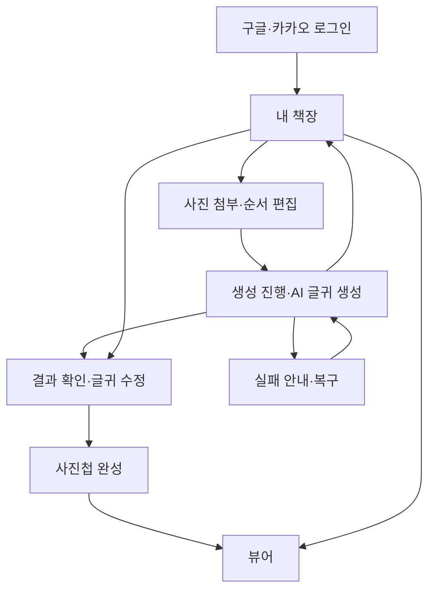
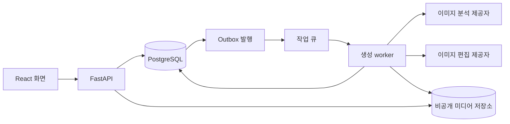
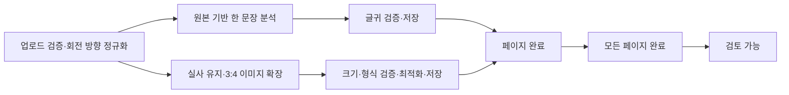

# AI 사진첩 제작 서비스 상세 설계

> 통합 전 이력입니다. 현재 기준은 [프로젝트 README](../../../README.md)에서 확인합니다.

- 작성일: 2026-10-15
- 버전: 0.3 — 정책 추천안 승인 및 제출 일정 반영
- 기준: 루트 기능요구명세서 및 이후 사용자 결정
- 2026-10-15 사용자 결정으로 10절의 구체적인 추천 정책을 승인했다. 수치·방식이 제시되지 않은 제공자·예산·계정 등의 미정 항목과 기술 검증 조건은 유지한다. 제품 코드·인프라는 아직 구현하지 않았다.

## 1. 제품 정의와 설계 범위

사진 1장을 1페이지로 구성하고 사용자 지정 순서를 유지한다. 최대 50장, 구글·카카오 로그인, AI 기반 세로 3:4 변환, 이미지 분석 기반 한 문장 생성, 별도 본문 표시, 완성 후 글귀 수정, 모바일 세로 뷰어·드래그/탭 넘김·페이지 번호·배경음악을 구현 대상으로 한다.

그림체 선택, 사용자 요청에 의한 이미지·글귀 AI 재생성, TTS, 굿즈·주문, NFC 접근 제한, 영상, 대량 자동 선별은 초기 범위에서 제외한다. 시스템 실패 재시도는 결과를 다시 만들어 달라는 제품 기능과 구분한다.

교육장 API는 필수 의존성에서 제외한다. 상용 이미지 편집 API와 이미지 분석 API를 사용하되 구체적인 제공자·모델·가격·지원 옵션은 실제 연동 전 검증한다. 이 문서는 특정 제공자의 기능이나 현재 배포 요금제를 보장하지 않는다.

### 설계 접근 비교

| 접근 | 장점 | 비용·한계 |
|---|---|---|
| 기존 서비스 전체를 복제 | 초기 화면 재사용 가능 | 결제·추천·영상·TTS 등 불필요한 운영 의존성과 데이터 모델까지 따라옴 |
| 필요한 모듈을 선별하고 사진첩 흐름 구성 — 추천 | 인증·저장·복구 경험을 재사용하면서 제품 범위를 유지 | 실제 코드 의존성 조사와 DTO 재설계 필요 |
| 모든 기능 신규 구현 | 제품에 맞는 작은 구조 | 인증·작업 복구 등 검증된 부분도 다시 구현 |

## 2. 화면 흐름



추천: 생성 전 초안, AI 처리 완료 후 검토 가능, 사용자 확인 후 완성을 구분한다. ‘AI 작업 완료’와 ‘사용자가 사진첩 완성’을 같은 상태로 취급하지 않는다. 책장 카드를 선택하면 초안은 편집, 생성 중은 진행, 검토 대기는 결과 확인, 완성은 뷰어, 실패는 복구 화면으로 이동한다.

### 화면 계약

| 경로 | 화면 | 주요 동작 | 이탈·실패 처리 |
|---|---|---|---|
| `/login` | 로그인 | 구글·카카오, 최초 동의 | 실패 안내, 로그인 후 내부 경로 복귀 |
| `/albums` | 내 책장 | 카드·상태·새 사진첩·개별 메뉴 | 빈 상태, 조회 재시도 |
| `/albums/:id/edit` | 초안 편집 | 사진 일괄 첨부·날짜순 기본 정렬·순서 변경 | 사진별 업로드 실패 표시, 서버 저장 여부 표시 |
| `/albums/:id/progress` | 생성 진행 | 완료 페이지 수·실패 수·책장 이동 | 새로고침 후 서버 상태 복원 |
| `/albums/:id/review` | 결과 검토 | 이미지와 AI 글귀·직접 수정·완성 | 저장 실패 표시, 실패 페이지 확인 |
| `/albums/:id/view` | 감상 | 이미지·짧은 본문·페이지·음악 | 현재 페이지 미디어 재조회·재시도 |

경로는 추천안이다. 별도 매니징 화면 대신 책장 카드 메뉴에 결과 확인·글귀 수정 진입과삭제를 두는 안을 권장한다. 생성 중 카드와 초안도 같은 책장에서 관리한다.

### 초안 편집

1. 로그인 후 사진첩 초안을 먼저 생성하여 서버 ID를 확보한다.
2. 여러 사진을 한 번에 선택하면 날짜순으로 기본 정렬한다. 업로드 완료 순서로 덮어쓰지 않는다. 사용자가 순서를 변경한 뒤에는 날짜순을 자동 재적용하지 않는다.
3. 썸네일·순서 번호·사진별 업로드 상태를 보여준다. 드래그 외에 앞/뒤 이동 조작도 제공한다.
4. 그림체·제목 입력과 별도 확인 단계는 두지 않는다. 초기 제목은 서버에서 ‘나의 사진첩’ 등 기본값을 부여하는 안을 제안한다. 제목 정책이 생성 진행을 막지 않도록 한다.
5. 화면을 나가기 전에 저장되지 않은 변경을 표시한다. 완료된 업로드는 다시 접속해 유지되지만 전송하지 않은 로컬 파일은 복원할 수 없다. 실패한 파일은 사용자 재선택이 필요할 수 있다.
6. 사진 첨부 화면에서 바로 생성한다. 모든 사진의 업로드·서버 검증 완료와 최소 사진 수·최대 사진 수 환경설정을 검사한다. 초기 최대값은 50장이다.

별도 생성 전 확인 화면은 제거한다. 업로드·동의·수량 검사와 AI 처리 안내는 사진 첨부 화면에 포함한다. 생성 전 글귀 입력을 요구하지 않는다.

### 날짜 정렬 정책

날짜순 기본 정렬은 확정이며 세부 기준은 추천안이다. 촬영일(EXIF DateTimeOriginal 등)을 우선 사용하고 없으면 파일 수정일, 둘 다 유효하지 않으면 업로드 예약 시각을 사용한다. 오래된 날짜부터 정렬하며 같은 날짜는 최초 선택 인덱스로 안정 정렬한다. 촬영일이 없는 사진은 ‘파일 날짜 기준’으로 구분할 수 있다. EXIF 시간대가 없으면 임의로 UTC로 변환하지 않고 원시 촬영일·시간대 유무·정렬에 사용한 출처를 기록한다. 정확한 시간대 정책은 검토한다.

날짜 추출은 업로드 검증 중 서버에서 수행하며 metadata 제거 전에 필요한 날짜만 구조화하여 저장한다. 검증이 끝난 초기 사진 목록에 기본 정렬을 한 번 적용한다. 사용자가 이미 수동 정렬한 경우 추가 업로드가 그 순서를 재배열하지 않도록 뒤에 추가하는 안을 제안한다. 촬영일이 없는 파일을 AI로 날짜 추정하지 않는다.

### 결과 확인·글귀 수정

생성 진행 단계에서 모든 페이지의 AI 글귀를 생성·검증·저장한다. 일부 글귀가 먼저 완료되어도 사용자는 편집할 수 없다. 모든 페이지의 이미지·글귀 처리가 완료된 뒤 `review_ready`로 전이하고 결과 확인 화면에서 수정 가능하게 한다. 서버의 글귀 수정 API도 `processing`과 `action_required`에서 거부한다.

별도 글귀 편집 화면은 만들지 않는다. 결과 확인·글귀 수정 화면 하나에서 최초 검토와 완성 후 수정을 모두 처리한다. 초기 검토 후 ‘사진첩 완성’ 처리의 세부 버튼은 UI 설계안으로 유지한다. 수정 저장 방식은 아직 확정하지 않으며 저장 버튼·자동저장 중 추후 결정한다. 정상 AI 결과는 편집 개방 전에 모두 확정하고, 종료된 task의 중복·늦은 응답은 상태·시도 검증으로 무시한다. 사용자 수정 후 AI로 글귀를 다시 생성하지 않는다.

본문 최대 길이와 AI 목표 길이는 환경변수로 관리한다. 제안 초기값은 최대 80자·AI 목표 20~45자이며 아직 수치 승인은 받지 않았다. 정확한 제한은 작은 모바일 화면과 큰 글자 설정에서 가독성 확인 후 정한다. 긴 입력을 조용히 자르지 않고 제한을 안내한다. 빈 글귀 허용은 미정이다.

### 뷰어

- 3:4 이미지의 주요 내용이 잘리지 않도록 `contain` 표시를 기본안으로 한다. 기기 비율이 다르면 남는 영역을 따뜻한 배경으로 채운다. 고정 75%/25%와 이미지 3:4를 모든 화면에서 동시에 강제하지 않는다.
- 좌측 가장자리 20% 탭은 이전, 우측 20% 탭은 다음, 중앙 탭은 최소 제어 표시/숨김을 추천한다. 드래그 종료 후 발생한 탭은 무시한다. 음악 버튼·본문 편집 등 제어 조작이 페이지 넘김으로 전파되지 않게 한다.
- 사진·본문·작은 페이지 번호만 기본 표시한다. 음악 제어와 뒤로 가기는 접근 가능하게 유지하며 제어의 자동 숨김은 사용성 검증 후 정한다.
- 첫 이미지와 다음 이미지가 준비되면 감상을 시작하고 현재·인접 페이지를 우선 로드한다. 50장을 모두 다운로드할 때까지 막지 않는다. 실패한 인접 이미지 때문에 현재 페이지 감상을 막지 않는다.
- 고정 배경음악 한 곡을 추천한다. 명시적인 첫 재생 조작, 켜기/끄기, 뷰어 이탈·백그라운드 시 정지, 복귀 시 사용자 조작 재개를 기본안으로 한다. 음원 권리를 확인한다.
- 키보드 좌우키와 접근 가능한 이전/다음 조작, 모션 감소 설정을 지원한다. 화면 회전과 크기 변경 시 현재 페이지를 유지한다.

## 3. 시스템 구성과 책임



이전 논의의 Render + R2를 배포 후보로 유지한다. 실제 서비스 종류·큐 명령·요금·도메인 구성은 배포 설계 때 확인한다. 브라우저는 AI 키를 보유하지 않는다. API는 인증·입력 검증·작업 접수를, worker는 오래 걸리는 AI 처리를 담당한다. DB가 작업 상태의 기준이며 큐는 실행 알림 역할이다.

공통 계약은 `ImageTransformPort`, `CaptionGenerationPort`, `MediaStoragePort` 정도로 제한한다. 분석과 이미지 변환에 같은 제공자를 강제하지 않는다. 서버 설정에서 실제 adapter를 조립하며 지원하지 않는 기능을 대체 성공 처리하지 않는다. provider SDK의 응답 구조를 화면 DTO나 DB 핵심 모델로 전파하지 않는다.

## 4. 데이터 구조

UUID 기반 ID, UTC 시각, 외래키와 사용자 소유권을 사용한다. 사진 순서는 DB에 명시적으로 저장한다. 아래 테이블은 신규 설계안이며 기존 테이블의 그대로 복사를 뜻하지 않는다.

| 테이블 | 핵심 필드 | 역할·제약 |
|---|---|---|
| `users` | id, display_name, created_at, deleted_at | 서비스 사용자 |
| `auth_identities` | user_id, provider, provider_subject | `(provider, provider_subject)` unique. 이메일 일치만으로 계정 자동 병합 금지 |
| `sessions` | user_id, token_hash, expires_at, revoked_at | 로그아웃·세션 철회. 원문 세션 토큰 저장 금지 |
| `consents` | user_id, policy_version, purpose, agreed_at | 업로드·외부 AI 처리 고지에 대한 동의 이력 |
| `albums` | id, owner_id, title, status, version, cover_page_id, created_at, published_at, deleted_at | 사진첩과 상태. 초기 스타일 필드·스타일 enum은 만들지 않음 |
| `album_pages` | id, album_id, position, source_asset_id, result_asset_id, ai_caption, caption_text, caption_edited_at, captured_at_raw, captured_timezone, sort_date, sort_date_source, selection_index, version | `(album_id, position)` unique. 생성 원문과 현재 표시 글귀 구분 |
| `media_assets` | id, owner_id, album_id, role, storage_key, mime, bytes, width, height, checksum, status | 원본·정규화 입력·결과·썸네일 관리. 만료 URL은 저장하지 않음 |
| `upload_sessions` | id, owner_id, album_id, asset_id, status, expires_at | 업로드 예약·완료·검증. 예약 중 사진도 50장 제한 계산에 포함 |
| `generation_runs` | id, album_id, input_version, status, idempotency_key, request_hash, config_snapshot | 생성 입력·프롬프트 버전·provider/model 고정. 사진첩별 활성 run 하나 |
| `generation_tasks` | id, run_id, page_id, stage, status, attempt_count, next_retry_at, lease_until, fence_version | 페이지별 caption/image/optimize 단계. `(run_id,page_id,stage)` unique |
| `task_attempts` | id, task_id, attempt_no, provider_request_id, status, usage, estimated_cost, error_code, timestamps | 요청·응답 불확실성 및 사용량 기록. 원본 사진·전체 프롬프트 로그 금지 |
| `outbox_events` | id, event_type, entity_id, payload, published_at | DB commit 후 큐 발행 유실 복구 |

관계: 사용자 1:N 사진첩, 사진첩 1:N 페이지, 페이지가 원본·결과 미디어를 참조한다. 생성 run은 해당 시점의 입력 버전과 페이지 목록을 고정한다. 생성 중 사진·순서 변경은 막는다. 완성 후 초기 수정 범위는 글귀이며 이미지 교체·스타일 변경을 노출하지 않는다.

추천: 첫 페이지를 표지로 사용하고 초안에는 원본 썸네일, 완료 후에는 결과 썸네일을 표시한다. 외부 URL을 cover 필드에 복제하지 않는다. 순서 변경은 전체 페이지 ID 배열을 한 transaction에서 검증·반영하며 unique 충돌을 피하는 방식으로 저장한다.

### 상태

| 사진첩 상태 | 의미 | 가능한 다음 상태 |
|---|---|---|
| `draft` | 사진·순서 편집 | processing, deleted |
| `processing` | 서버 생성 작업 진행 | review_ready, action_required, deleted |
| `action_required` | 일부 단계 실패 또는 결과 불확실 | processing, deleted |
| `review_ready` | 모든 페이지 결과 확보, 글귀 검토 가능 | published, deleted |
| `published` | 감상 가능한 완성 사진첩 | published(글귀 수정), deleted |
| `deleted` | 접근 차단, 파일 정리 진행 | terminal |

작업 상태는 queued/running/retry_wait/succeeded/failed/unknown/cancelled를 사용한다. unknown은 요청 전송 후 결과를 확인하지 못한 상태다. 실패와 진행 중을 동일하게 표시하지 않는다. 모든 결과가 갖춰져야 review_ready로 전이하는 초기안을 추천한다. 일부 성공 페이지는 보존하고 내부 검토 화면에서 확인할 수 있으나 실패 페이지를 숨긴 채 완성 처리하지 않는다.

## 5. API 계약

기본 prefix `/api/v1`. 모든 리소스 요청에서 세션과 소유권을 검사한다. 다른 사용자의 ID 요청은 404로 일관되게 처리한다. 예시는 제공자 독립 계약이며 기존 API 호환 여부는 코드 조사 후 결정한다.

| Method / 경로 | 주요 요청 | 응답·규칙 |
|---|---|---|
| GET `/auth/{provider}/start` | provider=google/kakao | OAuth 시작, state·nonce·허용된 내부 복귀 경로 |
| GET `/auth/{provider}/callback` | code/state | 서버 검증 후 세션 발급·화면 복귀. provider별 검증 계약 준수 |
| GET `/me` | — | 사용자 요약 |
| POST `/auth/logout` | CSRF 보호 | 세션 철회 |
| GET `/albums?cursor=&limit=` | cursor | 카드 목록·상태·다음 cursor |
| POST `/albums` | title? (서버 기본값 사용) | 201 초안 ID·version |
| GET `/albums/{id}` | — | 상태·순서·글귀·썸네일, 원본 대용량 데이터 제외 |
| PATCH `/albums/{id}` | title, expected_version | 허용 상태 확인, version 증가 |
| POST `/albums/{id}/uploads` | filename, mime, bytes | 업로드 예약·asset_id·제한된 업로드 URL |
| POST `/albums/{id}/uploads/{upload_id}/complete` | — | 서버에서 실제 파일 검증 예약. 클라이언트 완료 신고를 곧바로 검증 완료로 취급하지 않음 |
| GET `/albums/{id}/uploads/{upload_id}` | — | validating/ready/rejected 상태 |
| DELETE `/albums/{id}/pages/{page_id}` | expected_version | 초안에서만 제거 |
| PUT `/albums/{id}/page-order` | page_ids, expected_version | 누락·중복·다른 사진첩 ID 차단 |
| POST `/albums/{id}/generation` | expected_version, Idempotency-Key | 202 run_id·status_url. DB 기록 후 반환 |
| GET `/albums/{id}/generation` | — | run 상태·완료 수·실패 수·페이지별 단계 |
| POST `/albums/{id}/generation/resume` | run_id, Idempotency-Key | 재시도 허용된 실패 단계만 재개. 성공 결과 재생성 금지 |
| PATCH `/albums/{id}/pages/{page_id}/caption` | caption_text, expected_version | review_ready/published에서만 사용자 글귀 저장. AI 호출 없음 |
| POST `/albums/{id}/publish` | expected_version | 전체 결과·저장 상태 확인 후 published |
| GET `/albums/{id}/viewer` | — | published 페이지의 순서·글귀·표시용 미디어 URL·만료시각·음원 정보 |
| POST `/albums/{id}/media-access` | asset_ids | 소유권 검사 후 필요한 미디어 URL 갱신 |
| DELETE `/albums/{id}` | expected_version | 202 접근 차단 후 비동기 파일 정리 |

업로드 URL 방식은 저장소 기능을 검증한 뒤 채택한다. asset 경로는 서버가 지정하며 사용자가 임의 storage_key/외부 URL을 넘겨 worker가 다운로드하게 하지 않는다. CSRF 보호, cookie·CORS·OAuth callback을 배포 도메인 구성과 함께 설계한다. 추천은 브라우저가 JavaScript에서 읽을 수 없는 Secure·HttpOnly 세션 cookie이며 cross-site cookie에 의존하지 않는 도메인 구성을 검토한다.

### 응답 예시

```json
{
  "run_id": "uuid",
  "status": "processing",
  "total_pages": 50,
  "completed_pages": 18,
  "failed_pages": 1,
  "active_stage": "image_transform",
  "poll_after_ms": 3000
}
```

진행률은 이미지·글귀·최적화가 모두 성공한 페이지 수를 기준으로 한다. 실제 완료 근거가 없는 99%나 남은 시간을 보여주지 않는다. 화면이 보일 때 약 3초 간격, 장기 진행 시 간격을 늘리는 polling을 추천한다. 백그라운드 polling은 중단한다.

에러 형식은 `error.code`, `message`, `retryable`, `request_id`, `details`로 통일한다. 409는 버전·상태·동일 idempotency key의 다른 요청 충돌, 413은 용량, 422는 입력, 429는 사용량·동시 실행 제한에 사용한다. provider 원문 에러·키·개인 사진 URL은 반환하지 않는다.

동일 사용자·동일 idempotency key·동일 요청 본문이면 이전 결과를 반환하고, 본문이 다르면 409다. 새 키로 반복 요청해도 활성 run unique 제약으로 중복 생성이 생기지 않도록 한다.

## 6. 생성 처리 순서

### 6.1 요청 접수

1. 사용자 소유권·동의·사진 수·업로드 검증·사용량 제한을 검사한다.
2. 사진 순서와 원본, 적용 제한 설정, provider/model·프롬프트 버전을 입력 스냅샷으로 고정한다.
3. 한 DB transaction에서 run·페이지별 task·outbox·사진첩 상태를 저장한다.
4. API는 202를 반환한다. HTTP 요청에서 50장 생성을 기다리지 않는다.

### 6.2 페이지 처리



**추천: 글귀는 변환 이미지가 아니라 원본 사진을 분석한다.** AI가 확장하면서 만든 가상의 배경을 실제 추억으로 설명하지 않게 하고, 이미지 변환과 글귀 생성을 독립 실행할 수 있다. 이름·관계·장소·날짜·감정을 근거 없이 확정하지 않도록 프롬프트를 설계한다. 사진 속 글이나 지시를 시스템 명령으로 취급하지 않는다.

이미지 변환은 원본 사진의 실사 느낌을 유지하면서 세로 3:4 결과를 만드는 작업이다. 인물·주요 사물 보존을 목표로 한다. 이미 세로 3:4인 원본사진은 승인된 비용 절감 정책에 따라 AI 이미지 확장을 생략한다. 회전 방향 정규화 후 비율을 확인하고 글귀 분석과 표시용 최적화는 수행한다.

그림체 변환은 하지 않는다. 원본을 중앙에 배치하고 부족한 영역만 확장하는 마스크 방식은 제공자 지원과 품질을 확인한 뒤 채택한다. 인물 보존을 완벽히 보장하지 않는다. 결과 비율이 잘못되면 검증 실패로 처리하며 크롭·왜곡으로 조용히 맞추지 않는다.

글귀 응답은 구조화된 `caption` 문자열 하나로 받는 방식을 추천한다. 한 문장·길이·빈값을 검증한다. 형식 오류의 제한적 시스템 재시도는 사용자 재생성과 다르며 비용 기록을 남긴다. 다듬기를 위해 정상 응답에 추가 AI 호출을 반복하지 않는다.

### 6.3 동시성·재시도·비용

- 초기 동시성 제안: 사용자별 활성 사진첩 1개, 이미지 작업 전체 2개, 글귀 작업 전체 4개. 실제 provider 한도와 예산 측정 후 변경한다. 사용자 5명이 각각 50장을 올려도 250개 요청을 한꺼번에 보내지 않는다.
- worker는 task lease와 fence_version으로 소유권을 확보한다. 오래된 worker 결과는 현재 task를 덮어쓰지 않는다. provider별 timeout과 lease 연장을 맞춘다.
- 안전하게 재시도 가능한 네트워크 연결 전 실패·429·일시 장애는 지수 backoff와 최대 횟수로 제한한다. 입력 오류·정책 차단은 무한 재시도하지 않는다.
- provider가 요청을 받았지만 응답이 유실된 경우 unknown으로 기록한다. provider request ID·상태 조회·idempotency 지원을 이용해 먼저 확인하며 지원이 없으면 자동 재호출하지 않는다. 외부 과금의 exactly-once를 보장한다고 주장하지 않는다.
- 결과 파일을 이미 받았다면 저장·최적화 실패 때문에 AI를 다시 호출하지 않는다. 파일 보존 지점과 DB commit 사이 장애를 복구하고, orphan 파일은 정리한다.
- 내부 storage key는 task/attempt별로 분리하고 성공한 asset만 페이지에 연결한다. 재시도 worker가 같은 경로를 덮어쓰지 않는다.
- 삭제 요청 이후 도착한 provider 결과는 사진첩에 다시 연결하지 않고 정리 대상으로 보낸다. 진행 중 provider 호출의 취소 가능 여부는 제공자별 확인한다.
- run별 예상 비용 상한과 실제 사용량을 기록한다. 예약 비용이 한도를 초과하면 호출 전 중단한다. 제공자 불명확 비용도 별도로 기록한다. 사용자별 일일 횟수·월 예산 수치는 실제 5~10장 측정 후 정한다.

## 7. 파일·개인정보·삭제

원본 사진은 비공개 저장소에 보관하고 다운로드 URL은 DB에 저장하지 않는다. 회전 방향을 적용한 처리 입력을 만들고 EXIF 위치정보 등 불필요한 metadata를 제거하는 것을 추천한다. MIME 선언만 믿지 않고 파일 디코딩·픽셀 수·용량을 검사한다. HEIC 지원은 iPhone 핵심 경험에 영향을 주므로 실제 라이브러리·배포 환경 호환을 확인하여 도입 여부를 정한다.

초기 업로드 제안은 JPEG/PNG/WebP, 장당 20MB·최대 50장·총 300MB·최대 4천만 픽셀이다. 수치는 제품 확정값이 아니며 50장 실제 기기 업로드와 메모리 측정 후 정한다. HEIC를 지원하지 않으면 선택 전에 제한을 명시한다. 변환 중에도 원본 입력의 의미를 유지한다.

추천 보관안: 미완료 업로드는 24시간 후 정리, 중단 초안은 7일 후 사전 안내를 거쳐 정리, 완성 사진첩은 사용자 삭제까지 유지, 원본은 완성 후 7일 뒤 삭제하는 안을 검토한다. 원본 삭제와 시스템 재시도 가능 기간이 충돌하지 않도록 완료된 run 이후에만 적용한다. 실제 보관 기간·백업 수명·동의는 사용자 승인 전 확정하지 않는다.

삭제는 즉시 접근 차단 → 진행 task 취소 표시 → 원본·결과·썸네일 정리 → 완료 기록 순서다. 파일 삭제 실패는 다시 정리하며 접근 차단을 되돌리지 않는다. 백업까지 즉시 삭제한다고 안내하지 않는다. 검색·공유·NFC 기능의 미확정 여부와 무관하게 사용자 소유권과 미디어 접근 보호는 유지한다.

## 8. 기존 서비스에서 가져올 것

| 영역 | 재사용 후보 | 이 프로젝트에서 재설계할 부분 |
|---|---|---|
| 인증 | 구글·카카오 검증·세션 처리 | 독립 OAuth 앱·callback·동의, 불필요한 모바일/결제 연동 제외 |
| 책장 | 카드·목록 조회·상태 표현 | 사진첩 상태별 이동, 별도 관리 페이지 최소화 |
| 생성 | durable task·outbox·lease·재시도·storage 경계 | 사진별 이미지/글귀 2개 분기. 동화 planning·대사·TTS·영상 stage 제외 |
| 뷰어 | 페이지 데이터·미디어 접근 계약 | 첨부 UI 기반 세로·탭/드래그, TTS 없는 BGM |

위 표는 파일 복사 목록이 아니다. 원본 read-only 의존성 조사로 실제 필요한 파일·설정·모델을 확정한다. 운영 migration 전체를 가져오지 않고 필요한 스키마의 독립 초기 migration을 만든다. 기존 크레딧 정책은 일일 생성 제한·비용 상한으로 치환하는 안을 검토한다. 새 DB·큐·bucket·키만 사용한다.

## 9. 검증과 구현 분할

| 단계 | 결과물 | 반드시 확인할 동작 |
|---|---|---|
| 1. 화면과 데이터 계약 | 합성 샘플 기반 책장·편집·뷰어 | 사진 순서·별도 본문·탭/드래그·음악·모바일 가독성 |
| 2. 독립 계정·저장 | 로그인·DB·사진 업로드 | 두 provider 로그인, 사용자 격리, 50장 제한·실패 재선택·초안 복구 |
| 3. 소량 실제 AI | 분석·편집 adapter, 5~10장 품질/비용 기록 | 인물 보존·3:4·한 문장·provider timeout·비용 |
| 4. durable 생성 연결 | run/task/outbox·재시도·진행 조회 | 중복 요청·큐 재전달·worker 재시작·결과 불확실·부분 실패 |
| 5. 완성·수정·삭제 | 검토 완료·뷰어·본문 수정·정리 | 버전 충돌·늦은 AI 결과·삭제 후 결과 도착·미디어 만료 |
| 6. 배포·실사용 | 외부 URL·사용자 최소 5명 피드백 | iPhone/Android, OAuth callback, 재현 가능한 실행·개선 기록 |

실패 주입은 의미 있는 경계에서 수행한다. 특히 외부 AI 응답 유실 후 중복 과금, 50번째 사진만 실패한 경우, 편집 개방 전 모든 caption 완료와 늦은 중복 응답 차단, 삭제 직후 provider 완료, 미디어 URL 만료를 확인한다. 화면 배치만 확인하는 테스트로 생성 복구 검증을 대체하지 않는다.

## 10. 구현 전에 검토할 정책

2026-10-15 사용자가 나머지 추천안대로 진행하도록 승인했다. 구체적인 추천값은 확정으로 반영하고, 추천값이 없거나 실제 검증이 필요한 항목은 아래처럼 구분한다.

| 결정 | 적용 정책 | 상태 |
|---|---|---|
| 생성 완료 후 검토 단계 | 모든 처리 완료 후 글귀 확인·수정, ‘사진첩 완성’ | 확정 |
| 분석할 이미지 | 원본 사진 | 확정 |
| 이미 3:4인 원본사진 | AI 이미지 확장 생략, 글귀 분석·표시 최적화 유지 | 확정 |
| 글귀 정책 | AI 목표 20~45자·사용자 최대 80자, 환경변수 관리 | 수치 확정. 빈값 허용은 추천값이 없어 미정 |
| 그림체 선택 | 초기 제외·향후 확장 검토 | 확정 |
| 기본 제목·표지 | 별도 입력 단계 없이 기본 ‘나의 사진첩’·첫 페이지 표지 | 확정 |
| 관리 UI | 책장 카드 메뉴에서 결과 확인·글귀 수정 화면 재사용, 삭제 | 확정 |
| 업로드 | 최소 1장·최대 50장, JPEG/PNG/WebP, 파일당 20MiB·총 300MiB·4천만 픽셀 | 초기 제한 확정. HEIC 지원은 배포 환경 검증 후 결정 |
| 제공자·예산 | 상용 사진 편집·분석 API를 소량 측정 후 선정 | 접근 방식 승인. 모델·키·금액 상한 미정 |
| 개인정보 보관 | 미완료 업로드 24시간·중단 초안 7일 후 안내 기반 정리, 완성 사진첩은 사용자 삭제까지, 원본은 완료된 run 및 완성 후 7일 뒤 정리 | 추천안 승인. 백업 수명·정리 구현 확인 후 고지 |
| 일정 | 10월 18일까지 동작 가능, 19일 인터뷰·추가 자료 준비 후 제출 | 확정, Asia/Seoul 기준 |
| 팀·계정 | 팀 구성·역할·과제용 인프라 계정 | 사용자 정보 미제공 |


승인된 정책을 기능요구명세서에 반영하고, 실제 코드 의존성 조사 결과를 바탕으로 파일 단위 구현 계획을 작성한다. UI 시안 이미지는 방향 참고이며 자동으로 확정 디자인으로 취급하지 않는다.

## 11. 환경변수 기반 제한 관리

서버 설정을 단일 기준으로 사용한다. 프런트엔드 build 시 복제한 상수와 별도로 운영하지 않고 `GET /api/v1/client-config`에서 공개 가능한 제한만 받는다. 키·내부 예산·provider 비밀 설정은 반환하지 않는다. 서버도 모든 요청에서 같은 제한을 검증한다.

| 환경변수 | 초기값 | 의미 |
|---|---|---|
| `ALBUM_MAX_PHOTOS` | 50 — 확정 초기값 | 사진첩 최대 사진 수 |
| `ALBUM_MIN_PHOTOS` | 1 — 승인 | 최소 사진 수 |
| `CAPTION_MAX_CHARS` | 80 — 승인 | 사용자 본문 길이 상한 |
| `CAPTION_AI_TARGET_MIN_CHARS` | 20 — 승인 | AI 생성 목표 최소 길이 |
| `CAPTION_AI_TARGET_MAX_CHARS` | 45 — 승인 | AI 생성 목표 최대 길이 |
| `UPLOAD_MAX_FILE_BYTES` | 20971520 — 승인 | 파일당 용량 |
| `UPLOAD_MAX_ALBUM_BYTES` | 314572800 — 승인 | 사진첩 총 업로드 용량 |
| `UPLOAD_MAX_PIXELS` | 40000000 — 승인 | 디코딩 이미지 픽셀 수 |

환경변수는 API·worker에 동일하게 적용하고 잘못된 범위는 시작 단계에서 오류로 처리한다. 본문 길이의 문자 계산 기준은 서버·화면에서 일치시킨다. 설정 변경 후 재배포 또는 재시작이 필요하며 실행 중 관리자 화면 변경 기능은 만들지 않는다. 생성 run에 적용한 제한을 스냅샷으로 저장하여 진행 중 작업이 설정 변경으로 흔들리지 않게 한다. 이미 완성된 50장 사진첩은 이후 최대값이 줄어도 조회를 차단하지 않는다. 새 생성은 최신 제한으로 검증하며 기존 긴 본문은 자동 절단하지 않고 재편집 시 처리 방식을 안내한다.

## 12. 변경 이력

- v0.3: 10절 추천 정책 사용자 승인, 10월 18일 동작·19일 인터뷰 및 제출 목표 반영. 구체값 없는 항목은 미정 유지.

- v0.2: 그림체 선택을 향후 확장으로 분리. 별도 제목·확인 화면과 글귀 편집 화면 제거. 모든 AI 글귀 완료 후 결과 화면에서 편집 개방. 날짜순 기본 정렬과 환경변수 기반 제한 계약 추가.

## 13. 제출 일정

모든 날짜는 2026년 10월, Asia/Seoul 기준이며 아래 일별 배분은 실행 목표다. 실제 완료를 의미하지 않는다.

| 날짜 | 작업 목표 | 완료 판단 |
|---|---|---|
| 15일 | 독립 프로젝트 구조·원본 재사용 의존성·화면/API 계약 정리, 배포·AI 계정 준비 확인 | 가져올 모듈과 실행 계획 확보 |
| 16일 | 구글/카카오 로그인·초안·업로드·날짜 정렬·책장·샘플 뷰어 연결, 소량 AI 검증 | 내 사진 입력부터 결과 표시까지 기본 흐름 확인 |
| 17일 | 실제 이미지 확장·글귀 생성·진행 복구·결과 수정 연결, 외부 배포 | 실제 사진 기반 전체 흐름을 외부 URL에서 확인 |
| 18일 | 통합 검증·모바일 오류 수정·50장 경계·접근 제한·실패 복구, 인터뷰 준비 | 로그인→생성→수정→감상과 문서 재현 절차 동작 |
| 19일 | 최소 5명 실제 사용·인터뷰·피드백 수집, 핵심 개선·재검증, 발표·README·제출 자료 완성 후 제출 | 피드백과 개선 증거 및 제출물 확보 |

계정 준비와 AI 품질 검증을 마지막 날로 미루지 않는다. 19일 인터뷰 이후 개선·재검증 시간을 확보하고, 일정이 밀리면 미확정 굿즈·NFC·스타일·영상 등 확장 기능을 추가하지 않는다. 인터뷰 질문과 기록 양식은 18일까지 준비한다. 제출 시각은 아직 제공되지 않았다.
