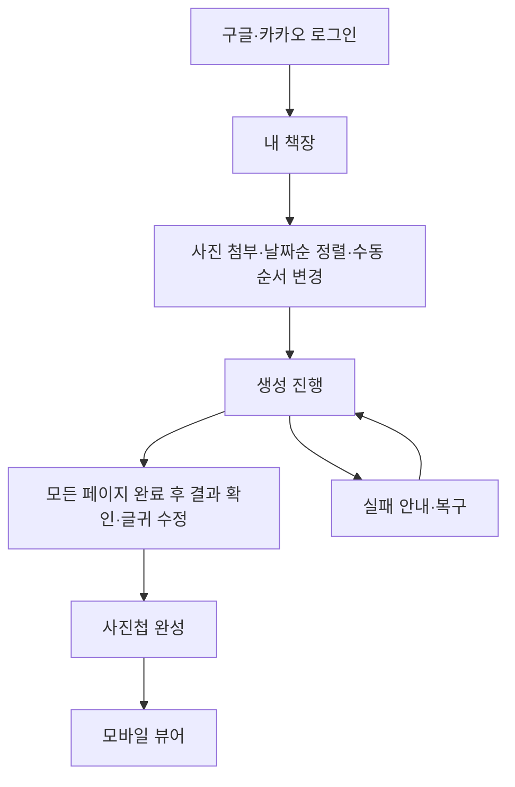
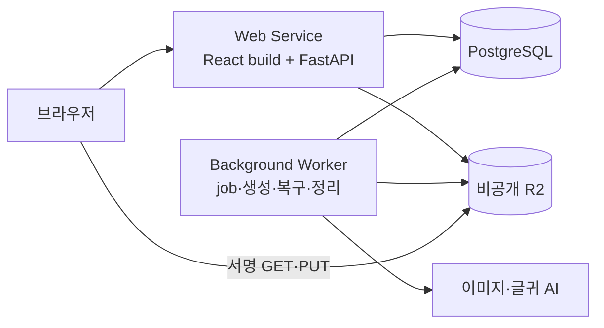

# 사진첩 화면과 기술 설계

- 정리일: 2026-10-16, Asia/Seoul
- 버전: 0.3 — 사용자 순차 실행 승인·계약 v1.3 반영
- 상태: 2026-10-16 사용자 순차 진행 지시에 따라 기술 시작 기준과 7절 보완안 채택. patch·성능·외부 연동 검증은 미실행. 배포 후보 채택이 유료 자원 생성 완료를 뜻하지 않음

화면 흐름과 추천 기술 구성·worker·미디어·AI 복구를 이 문서에서 관리한다. 데이터·API·상태·설정의 현재 기준은 [공통계약 v1.3](공통계약-v1.md), 기능 범위는 [기능요구명세서](../기능요구명세서.md)다. 계약과 다른 보완 제안은 7절에 따로 표시한다. 문서 정리로 기존 제안을 확정 정책으로 승격하지 않는다.

## 1. 화면 흐름과 뷰어

| 경로 | 화면 | 동작 기준 |
|---|---|---|
| /login | 로그인 | Google/Kakao, 실패 안내·내부 복귀 |
| /albums | 책장 | 카드·빈 목록·상태별 이동·개별 메뉴 |
| /albums/:id/edit | 초안 | 일괄 첨부·업로드 상태·날짜순 기본 정렬·수동 이동 |
| /albums/:id/progress | 진행·복구 | 실제 완료 수·실패·unknown, 새로고침 복원 |
| /albums/:id/review | 결과 확인·수정 | review_ready/published에서 글귀 저장, 최초 완성 처리 |
| /albums/:id/view | 감상 | published만 감상, 이미지·본문·페이지·BGM |

로그인 후 초안 ID를 먼저 만들고 사진을 예약·업로드한다. 파일 선택부터 반복 필수 입력을 최소화하고, 서버 검증 전에는 생성 가능으로 표시하지 않는다. 드래그 외 앞/뒤 이동 조작을 제공한다. 전송 전 로컬 파일은 화면 복귀로 복원되지 않을 수 있음을 안내한다.

스타일·제목·생성 전 확인·별도 글귀 편집 화면은 두지 않는다. 기본 제목은 ‘나의 사진첩’, 표지는 첫 페이지이며 책장 메뉴에서 수정·삭제에 진입한다. 생성 중·action_required에서는 글귀 편집을 열지 않는다. 모든 페이지 완료 뒤 같은 결과 화면에서 저장 버튼으로 수정하고 ‘사진첩 완성’ 처리한다. 완성 후에도 이 화면을 재사용한다.

저장 중·저장 완료·실패를 구분하고 미저장 이탈·완성은 안내한다. AI 목표 20~45자와 사용자 최대 80자, 사용자 빈 문자열 허용은 현재 계약 기준이다. 저장 응답 유실·동시 완성·일부 저장 실패 UX는 [검증계획의 D10](검증계획.md)에 따라 구체화한다. 날짜 출처·정렬·batch·버전 규칙은 [공통계약](공통계약-v1.md)에서만 관리한다.

### 뷰어 배치와 입력

- 3:4 이미지의 주요 내용이 잘리지 않도록 `contain` 표시를 기본안으로 한다. 기기 비율이 다르면 남는 영역을 따뜻한 배경으로 채운다. 고정 75%/25%와 이미지 3:4를 모든 화면에서 동시에 강제하지 않는다.
- 좌측 가장자리 20% 탭은 이전, 우측 20% 탭은 다음, 중앙 탭은 최소 제어 표시/숨김을 추천한다. 드래그 종료 후 발생한 탭은 무시한다. 음악 버튼·본문 편집 등 제어 조작이 페이지 넘김으로 전파되지 않게 한다.
- 사진·본문·작은 페이지 번호만 기본 표시한다. 음악 제어와 뒤로 가기는 접근 가능하게 유지하며 제어의 자동 숨김은 사용성 검증 후 정한다.
- 첫 이미지와 다음 이미지가 준비되면 감상을 시작하고 현재·인접 페이지를 우선 로드한다. 50장을 모두 다운로드할 때까지 막지 않는다. 실패한 인접 이미지 때문에 현재 페이지 감상을 막지 않는다.
- 고정 배경음악 한 곡: 사용자 지정 `assets/audio/bgm.mp3`를 연결했다(2026-10-17). 명시적인 첫 재생 조작, 켜기/끄기·반복, 뷰어 이탈·백그라운드 시 정지, 복귀 시 사용자 조작 재개를 적용했다. 세부 경로·검증은 `BGM-구현검증.md`를 따른다.
- 키보드 좌우키와 접근 가능한 이전/다음 조작, 모션 감소 설정을 지원한다. 화면 회전과 크기 변경 시 현재 페이지를 유지한다.

위 배치·터치 영역·제어 자동 숨김은 UI 설계안이며 실기기에서 확인한다. 현재 계약의 페이지 상태·소유권·미디어 URL 발급 규칙이 우선한다.

## 2. 기술과 버전 기준

| 영역 | 시작 기준 | 고정 방법과 확인 조건 |
|---|---|---|
| frontend runtime | Node.js 24 LTS, npm | 같은 Node major를 로컬·CI·Docker build에서 사용. 원본의 Node <23 제한은 복사하지 않음 |
| frontend | React 19, TypeScript 5.9, Vite 7 | 원본과 가까운 검증 시작 조합. 최신 버전이라는 의미가 아님. 호환 보안 패치와 plugin 조합을 build에서 확인 |
| router·서버 데이터 | React Router 7, TanStack Query 5 | SPA 라우팅, 조회·polling·cache 무효화. 기존 Book/JWT transport는 신규 작성 |
| HTTP client | 브라우저 fetch, 서버 httpx | frontend는 cookie·CSRF·공통 오류를 처리하는 작은 wrapper. refresh-token queue는 가져오지 않음 |
| backend runtime | CPython 3.12, Debian Bookworm 기반 Docker | Linux amd64를 첫 배포 검증 기준으로 사용. macOS import 성공을 배포 성공으로 대체하지 않음 |
| API·검증 | FastAPI 안정 릴리스, Pydantic 2, pydantic-settings 2, Uvicorn | Python 3.12와 동시에 resolve. FastAPI/Pydantic을 독립적으로 임의 업그레이드하지 않음 |
| DB | PostgreSQL 17 | 로컬·통합 테스트·배포에서 같은 major 사용. 운영 원본 DB에 연결하지 않음 |
| DB 접근 | SQLAlchemy 2, asyncpg, Alembic | API와 worker에 같은 repository·transaction 규칙. 새 migration부터 시작 |
| 미디어 | Pillow, pillow-heif, WebP·LittleCMS 기능이 포함된 build | native codec와 실제 decode/encode 검사. 개발 버전 대신 호환 안정 릴리스 사용 |
| storage | boto3, 비공개 Cloudflare R2 | asset→key 매핑, S3 presigned GET/PUT. 기존 CDN validator를 필수로 추가하지 않음 |
| 이미지 AI | GPT Image 2, 공식 OpenAI Python SDK | 모델 ID·WebP 입출력·정확한 3:4를 실제 서비스 키로 확인. SDK 자체 retry는 0으로 설정 |
| 글귀 AI | 독립 CaptionGenerationPort, OpenAI gpt-5.4-mini 우선 | 설정으로 모델 교체. 신규 run에 provider/model을 고정하고 진행 중 run은 기존 snapshot을 유지. 실제 adapter는 후속 구현 |
| 테스트 | pytest, Vitest, Playwright | PostgreSQL 통합 테스트와 실제 모바일 수동 검증을 포함 |
| 배포 | Lightsail 2GB 단일 VPS `ai_mori`: web·worker·PostgreSQL17·Caddy, 별도 R2 bucket | 2026-10-17 사용자 선택으로 Render 후보를 대체. web·worker는 같은 backend build, 실행 명령 분리. Redis·Celery·별도 frontend 서버는 추가하지 않음. [운영 절차](Lightsail-배포.md), 실제 2GB 부하는 검증 예정 |

위 숫자는 호환성을 확인할 major/minor 시작 기준이다. 정확한 patch와 transitive dependency가 검증됐다는 뜻이 아니다. 첫 기반 작업에서 frontend package-lock.json과 backend requirements.lock을 새로 만들고 성공한 container image digest를 기록한다. backend lock은 같은 Linux/Python 조합에서 pip-tools로 만들며 검증 시 `pip install --require-hashes -r requirements.lock`을 사용한다. frontend 재설치는 `npm ci`로 확인한다. 원본의 manifest·lock·Compose 전체를 복사하지 않는다.

Node 24의 LTS 상태는 [Node 공식 릴리스 자료](https://nodejs.org/en/about/previous-releases), Vite 7의 Node 요구사항은 [Vite 7 문서](https://v7.vite.dev/guide/migration)에서 확인했다. [SQLAlchemy asyncio 문서](https://docs.sqlalchemy.org/en/20/orm/extensions/asyncio.html)는 asyncpg 연결 구성을 제시한다. [pillow-heif 배포 자료](https://pypi.org/project/pillow-heif/)는 Python 요구사항과 wheel 파일을 제공한다. 이 자료들은 실제 선택 패키지 전체의 설치 성공을 증명하지 않는다.

## 3. 배포와 로컬 실행

web은 React 정적 build와 `/api/v1`을 같은 origin에서 제공한다. SPA fallback은 `/api` 오류나 없는 정적 파일을 index.html로 바꾸지 않도록 구분한다. 개발 시 Vite의 `/api` proxy를 사용해 같은 요청 경로를 유지한다. OAuth callback도 web origin을 기준으로 등록한다. R2 직접 접근에는 별도 bucket CORS가 필요하다.

worker는 HTTP 요청을 받지 않는다. DB에서 실행 가능한 작업을 찾아 제한된 수만 처리한다. 업로드 검증·복구·정리는 같은 worker 서비스에 배치하되 실행 슬롯과 우선순위를 분리한다. 첫 버전에는 별도 cron 서비스를 만들지 않고 worker의 주기 scanner가 정리 job을 DB에 예약한다.

로컬 Compose는 postgres·web·worker를 기본으로 한다. storage는 두 adapter를 둔다. 기본 개발 모드에서는 전용 local adapter가 새 제한 PUT/read route로 동작하고, R2 연동 검증에서는 새 서비스 전용 bucket을 사용한다. local 모드 성공을 R2 signing·CORS 성공으로 보고하지 않는다. local 파일 볼륨은 web·worker가 함께 사용하고 작업 공간별로 분리한다.

Render의 로컬 파일은 영속 저장으로 사용하지 않는다. source·정규화본·AI 응답의 복구 지점은 R2 object와 DB 참조다. 임시 디코딩 파일은 작업 디렉터리에 두고 정리한다. [Render background worker](https://render.com/docs/background-workers), [파일 수명](https://render.com/docs/disks), [R2 presigned URL](https://developers.cloudflare.com/r2/api/s3/presigned-urls/), [R2 CORS](https://developers.cloudflare.com/r2/buckets/cors/).

## 4. worker와 DB 작업 관리

### 실행 상태의 소유권

generation_tasks가 생성 task의 실행권·lease·fence를 단독으로 소유한다. 생성 task를 또 다른 job 테이블에 복제해 두 개의 상태 원장을 만들지 않는다.

업로드 검증·삭제·원래 응답 확인에는 별도 내부 background_jobs 테이블을 제안한다. 필드는 id, kind, target_id, status, attempt_count, next_retry_at, lease_until, fence_version, error_code, created_at, finished_at이다. kind는 validate_upload / cleanup_album / cleanup_asset / reconcile_attempt다. `(kind,target_id)`를 유일하게 관리하고 같은 job의 재시도는 상태·시도 횟수로 기록한다. 공개 AlbumStatus·UploadStatus는 늘리지 않는다.

`uploads/{id}/complete`에서 upload=validating과 validate_upload job을 같은 transaction에 기록한다. 생성 접수는 기존대로 run·generation_tasks·outbox·album 상태를 같은 transaction에 기록한다. 삭제 접수는 album=deleted·미완료 작업 취소·정리 이벤트를 원자적으로 저장한다. background_jobs 추가는 공통계약 내부 스키마 보완 대상이다.

worker는 두 종류의 작업 저장소에 같은 claim 원칙을 적용한다.

동시에 실행하는 task와 heartbeat는 각각 독립된 SQLAlchemy AsyncSession을 사용한다. boto3 I/O와 동기 OAuth token 검증은 thread 경계로 분리하고, 이미지 디코딩은 아래 자식 프로세스에서 처리한다. 이런 동기 작업이 event loop를 막아 다른 task의 lease 갱신을 중단하지 않도록 검증한다.

1. 실행 시각·현재 상태·선행 성공·실행 한도를 검사한다.
2. 짧은 transaction에서 `FOR UPDATE SKIP LOCKED`로 실행권을 확보하고 lease와 fence를 기록한다.
3. DB transaction을 종료한 다음 파일 처리나 외부 AI를 실행한다. AI 응답을 기다리며 row lock을 유지하지 않는다.
4. 결과 저장 뒤 현재 fence와 album 상태를 재확인하고 연결한다. 삭제·오래된 fence이면 연결하지 않고 정리한다.

outbox는 유지하되 초기 dispatcher가 외부 broker로 메시지를 보내지는 않는다. DB의 commit된 이벤트를 소비해 필요한 비생성 job을 멱등 예약하고, task_ready 이벤트는 실행 가능한 task의 존재를 확인한 뒤 소비 완료 처리한다. published_at은 초기 adapter에서는 DB 전달 처리가 끝난 시각이다. task 실행 완료 시각이 아니다. 이벤트 처리가 누락되어도 task와 stale job을 scanner가 재탐색한다. 이 의미 변경은 공통계약에 명시해야 한다.

[PostgreSQL 문서](https://www.postgresql.org/docs/current/sql-select.html)의 queue-like table 사용 방식에 근거한 설계다. 실행 순서의 엄격한 FIFO나 exactly-once 외부 과금을 보장하는 것은 아니다.

### 현재 개발 실행 설정 (2026-10-16 성능 보완)

| 설정 | 시작값 | 목적 |
|---|---|---|
| worker 서비스 수 | 1 | 초기 운영과 전역 제한을 단순화 |
| DB 작업 조회 간격 | 실행 가능 작업이 없을 때 1초 | 주기 조회와 중단 작업 복구 |
| 업로드 검증 슬롯 | worker 프로세스당 1 | 생성 응답 대기와 분리, HEIC 디코딩·WebP 정규화 |
| 생성 결과 최적화 슬롯 | DB 전체 1 | 검증 lane과 별도로 실행; 두 미디어 자식이 동시에 실행될 수 있음 |
| 이미지 AI 슬롯 | 2 | 기존 상세설계 제안 유지, 실제 한도 확인 후 조정 |
| 글귀 AI 슬롯 | 4 | 이미지와 별도 동시성 관리 |
| lease / heartbeat | 90초 / 15초 | 외부 호출 중 실행권 연장 |
| upload 검증 제한 시간 | job당 120초 | 영구 validating 감지. 실패 시 프로세스 격리·보존 원본 복구 |
| 이미지 / 글귀 요청 timeout | 300초 / 60초 | 초기 요청 설정. provider 실제 응답 시간 측정 후 조정 |
| 안전한 자동 재시도 | 최초 포함 최대 3회, 5초·20초 backoff와 jitter | not_sent·명확한 일시 거절·로컬 I/O만. Retry-After가 있으면 우선 |
| SDK 유료 요청 자동 재시도 | 0 | task 정책 밖의 숨은 호출 방지 |

이미지 디코딩은 별도 자식 프로세스에서 수행한다. timeout·메모리 초과로 해당 프로세스를 종료해도 supervisor와 AI heartbeat가 계속 동작하도록 한다. 초기 media child 메모리 예산은 512MiB로 측정하고 worker 서비스는 최소 1GiB를 시작 후보로 삼는다. 실제 40MP·HDR·50장 순차 입력의 최고 RSS가 서비스 한도의 80% 이하인지 확인한 뒤 배포 크기를 정한다. 이 수치는 성능 측정 결과가 아니다.

현재 생성 실행 admission은 DB transaction advisory lock과 album → run → task → page 잠금 순서로 전역 이미지 2·글귀 4·최적화 1 및 run 스냅샷 상한을 함께 적용한다. 완료 결과의 복구·settlement는 새 AI 호출 없이 처리한다. 업로드 검증은 프로세스당 1이므로 worker 수를 늘리면 검증 동시 수도 늘어난다. 슬롯 상한은 현재 코드의 고정 상한이며 환경변수로 무제한 확대하지 않는다. 배포 메모리 크기는 검증과 최적화 병행 부하를 추가 측정한 뒤 확정한다.

저장소는 작업마다 authoritative 원본을 한 번 읽고 크기와 SHA-256을 확인한 동일 바이트를 처리한다. 공유 cache 경로 대신 작업별 임시 파일을 사용한다. R2의 GET·HEAD·조건부 PUT·DELETE는 standard SDK 재시도를 최초 포함 최대 3회 허용하며, 불명확한 PUT 결과는 동일 바이트/불변 객체 계약으로 확인한다. OpenAI 유료 요청의 SDK 재시도 0과 unknown 재호출 금지는 그대로 유지한다.

`mori.performance` JSON 로그로 검증 입력/정규화/저장, 생성 실행/AI provider/결과 저장, 저장소 요청과 다운로드 시간을 구분한다. 오류는 종류·HTTP 상태만 허용하고 URL·object key·원문·사진·키는 기록하지 않는다. 검증의 queue_age_ms는 해당 job 생성부터 현재 attempt까지의 경과로, 재시도 시 이전 실행 시간도 포함한다. 생성 task에는 생성 시각이 없으므로 순수 큐 대기 시간을 따로 단정하지 않는다.

## 5. 업로드와 미디어 처리

### 업로드 수명과 복구 제안

- upload_sessions.expires_at은 예약시각+900초이며 complete 접수 기한이다. 만료는 파일 보관 기한과 구분한다.
- 기한 안에 complete가 접수되면 validating으로 바꾸고 job을 예약한다. 이후 PUT URL 만료만으로 검증을 중단하지 않는다.
- complete가 기한 뒤 처음 도착하면 expired로 판정한다. 이미 올라온 파일도 검증 없이 ready로 만들지 않고 미완료 파일 정리 대상으로 둔다. 초기 원본 정리 시점은 예약 후 24시간이다.
- validating job의 lease가 만료되면 보존된 source와 중간 파일을 확인해 재대기한다. 변환은 외부 유료 호출이 없으므로 AI unknown 정책과 구분한다.
- 같은 upload의 검증 결과 연결은 job fence·현재 upload/album 상태를 검사한다. 재전달·중복 complete가 파생본을 계속 만들지 않도록 입력 checksum과 정규화 설정 버전을 함께 확인한다.

기존 계약의 슬롯·용량 계산, batch 날짜 정렬·수동 순서 보존은 유지한다. 동의가 없는 사용자는 업로드 예약부터 403 CONSENT_REQUIRED로 막는 보완안을 적용 대상으로 둔다.

### 이미지 파이프라인

`source 보관 → 파일 디코딩·제한 검사 → 촬영일 추출 → 방향 적용 → input_is_3_4 계산 → 색상·HDR 정규화 → WebP 저장·썸네일 → ready`

공통계약 v1.6에 따라 원본 별도 보존과 무손실 의무를 해제하고 서비스용 축소·손실 WebP를 허용한다. 크롭·왜곡은 금지한다. 새 예약은 손실 품질90과 변환기 version2를 사용하고 기존 예약은 version1로 복구한다. 결과 quality=90, 썸네일 quality=80·긴 변 480px는 유지하며 normalized 기본 품질은90이다. 이미 조건을 충족한 AI WebP는 재압축하지 않는다.

색상은 세 경로로 나눈다.

| 입력 | 처리 경로 | 통과 조건 |
|---|---|---|
| 일반 SDR sRGB | 방향 적용, 불필요 메타데이터 제거, WebP | 픽셀 방향·alpha·표시 색상이 기대값과 일치 |
| ICC가 있는 SDR 광색역 | Pillow ImageCms/LittleCMS로 sRGB 변환 | 단순 RGB mode 변경으로 대체하지 않음. 참조 이미지와 색상 비교 |
| HDR/PQ/HLG 또는 gain map 포함 | decoder가 주는 SDR base rendition의 존재·의미를 확인하고, 없다면 transfer function을 고려한 tone mapping 경로 검증 | iPhone 참조 SDR 표현과 노출·중간톤·피부색·하이라이트 비교. 10bit→8bit만 수행한 결과를 합격시키지 않음 |

첫 codec 검증은 Pillow+pillow-heif로 수행한다. HDR 기준을 충족하지 못하면 model을 바꾸지 않고 media 내부에 HDR 변환기를 추가한다. libheif 출력 정보와 입력 codec 지원을 확인한 후 libvips 또는 FFmpeg 등 후보 중 실제 HEIF 입력·전달특성 처리에 성공한 하나를 선택한다. 특정 추가 도구가 HEIC HDR 전체를 지원한다고 미리 확정하지 않는다. 기존 계약의 HEIF/HEIC 필수 지원을 제거하는 대응은 하지 않는다.

## 6. AI 응답 보존과 unknown

AI 호출 전에 attempt_id, provider/model, 요청 설정, 발송 상태를 기록한다. SDK 자동 retry는 끄고 worker가 허용된 재시도를 결정한다. 실제 전송 여부를 확인할 수 없는 timeout은 unknown이다.

응답을 받으면 attempt별 deterministic object key에 bytes를 R2로 저장하고 checksum·asset 참조를 기록한다. object 저장 이후 DB commit이 실패하면 같은 key로 원래 결과를 찾는다. task 완료는 저장·검증·현재 fence 확인 이후다. 이미지 저장 실패를 AI 호출 실패로 바꾸지 않는다.

R2 저장 전 프로세스가 종료되면 로컬 임시 파일만으로 복구를 보장하지 않는다. provider 원래 요청 조회나 보존 파일로 결과를 확인하지 못하면 unknown을 유지한다. 원래 결과를 회수할 수 없는 동기 이미지 요청에서 자동 재호출로 정상 완료를 가장하지 않는다.

현재 공개 계약에서 사용자 종료 수단은 사진첩 삭제다. 초기 UI는 ‘결과를 확인할 수 없어 자동 재시도하지 않습니다’와 삭제 동작을 안내한다. 삭제는 활성 run 제한을 해제한다. 결과를 보존하는 별도 취소·포기 기능을 추가하려면 상태·endpoint·보관 정책 변경이 필요하며 이번 기술 구체안의 실행 범위에 넣지 않는다.

혼합 실패는 다음 보완안을 제안한다.

| 현재 결과 | 재개 동작 | 상태 |
|---|---|---|
| unknown 없음, 안전한 failed 있음 | 실패 단계만 재대기 | processing으로 복귀 |
| unknown 있음, 저장·최적화 등의 안전한 로컬 failed 있음 | 원래 결과 확인과 로컬 복구만 실행. 새 AI 호출 금지 | action_required 유지 |
| unknown 있음, 새 AI 호출이 필요한 failed만 있음 | can_resume=false. 확인/삭제 안내 | action_required 유지 |
| 원래 결과 확인과 로컬 복구로 모두 완료 | 정상 결과 연결 | review_ready, run=succeeded |

두 번째 행은 v1.3의 resume에서 action_required를 유지하며 대응 GenerationView fixture를 함께 갱신했다. task.retryable도 현재 run의 unknown 여부와 로컬/AI 실행 종류를 반영하여 can_resume과 일치시킨다.

## 7. 공통계약 v1.3에 반영한 보완

| 보완 | 영향 | 상태 |
|---|---|---|
| background_jobs 및 업로드 검증 원자 접수 | 내부 DB·complete application·worker·검증 추가. 공개 enum 유지 | v1.3 반영 |
| outbox의 초기 DB dispatcher 의미 | published_at·재탐색·단일 원장 정의 명시 | v1.3 반영 |
| upload expires_at=complete 기한, 정리는 별도 24시간 | 만료 경계·복구 fixture 추가 | v1.3 반영 |
| 최신 동의 검사부터 업로드 예약 차단 | API 검사·403 fixture·동의 UI 추가 | v1.3 반영 |
| unknown 혼합 시 로컬 resume만 허용·action_required 유지 | resume 상태/TaskView.retryable/can_resume·샘플 변경 | v1.3 반영 |

위 보완은 공통계약 v1.3과 만료·동의 오류·혼합 실패 샘플에 반영했다. 이후 구현 타입과 검증은 v1.3을 기준으로 작성한다. 세션 수명·글귀 한 문장 판정·음원·제출 팀 조건은 [검증계획](검증계획.md)의 담당·결정 시점을 따른다.

## 8. 보관과 삭제

보관의 현재 기준은 미완료 업로드 24시간 후 정리, 중단 초안 7일 후 안내 기반 정리, 완성 사진첩은 사용자 삭제까지, 원본 별도 보존 의무는 v1.6에서 해제했다. 임시 source는 서비스용 입력과 메타데이터 확보 및 참조·재시도 안전성을 확인한 뒤 정리하도록 전환한다. 미완료·unknown 복구의 유일한 입력은 유지하며 현재 source 의존 코드 전환 전에는 제거하지 않는다. 초안 중단 기준·안내 수단·backup 수명·정리 완료 기록은 [검증계획 D12](검증계획.md)에서 추적한다.

삭제는 즉시 DB/API 접근 차단 → 미완료 작업 취소 → 원본·파생본 정리 → 완료 기록 순서다. 기존 signed URL의 잔여 접근과 backup 수명은 별도이며 즉시 파일 전체 철회를 보장하지 않는다. 상세 데이터·미디어·상태 규칙은 [공통계약](공통계약-v1.md)을 따른다.

## 9. 검증과 구현으로 연결

설치·codec·DB·worker·외부 연동·모바일 검증 명령과 합격 조건은 [검증계획](검증계획.md)의 V01~V10을 따른다. 담당·편집 소유권·착수 순서·제출 일정은 [개발운영](개발운영.md)에서 관리한다. 실제 재사용 후보·원본 근거는 [재사용조사](재사용조사.md)를 따른다.

외부 연동 준비값은 새 Google/Kakao OAuth 앱, R2 bucket/서비스 키, OpenAI 서비스 키·사용 가능한 이미지 model ID, 글귀 provider/model, 호출 예산, 배포 서비스 plan·도메인·DB 버전, 권리 확보 음원이다. 이미 3:4 변환 품질을 확인한 GPT Image 2는 유지하고 해당 서비스 계정에서의 입출력·저장·비용 경계를 확인한다.

## 실제 연동 준비 상태 갱신 (2026-10-16)

2026-10-16 사용자 준비 상태 갱신: 새 서비스용 Google/Kakao OAuth 앱, R2 bucket, OpenAI 계정·키는 준비됨(사용자 보고; 실제 접속 검증 전). 글귀 모델은 `gpt-5.4-mini`를 우선 사용하고 설정으로 교체 가능하게 구성한다. 실제 AI 검증 예산은 이미지·글귀 합산 총 최대 USD 100이며, 최소 호출로 검증한 뒤 필요할 때 단계적으로 확대한다. 이는 예산 상한이며 소비 목표가 아니다. 현재 구현의 local_test_bound/estimated_cost=0은 실제 USD 예산 통제가 아니므로 외부 adapter 연결 전에 별도 누적 사용·사전 비용 예약·불명확한 호출 비용 보수적 반영을 설계한다. 실제 연결·모델 접근·키 배치·비용 통제는 아직 검증하지 않았다. 기존 서비스 자원은 사용하지 않는다.

[GPT-5.4 mini 공식 모델 문서](https://developers.openai.com/api/docs/models/gpt-5.4-mini)는 이미지 입력과 텍스트 출력을 지원한다고 명시한다. 정규화 원본 기반 한 문장·NFC 80자 정책은 유지한다. port는 공통계약의 경계이며 현재 실행 구현은 FakeExecutor다. 실제 OpenAI adapter 선택·설정·예산 ledger 연결은 후속 구현으로 구분한다.
